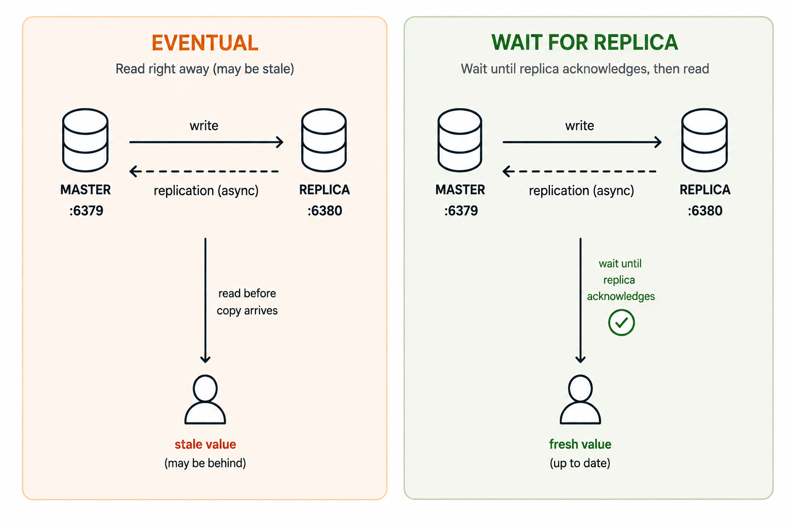
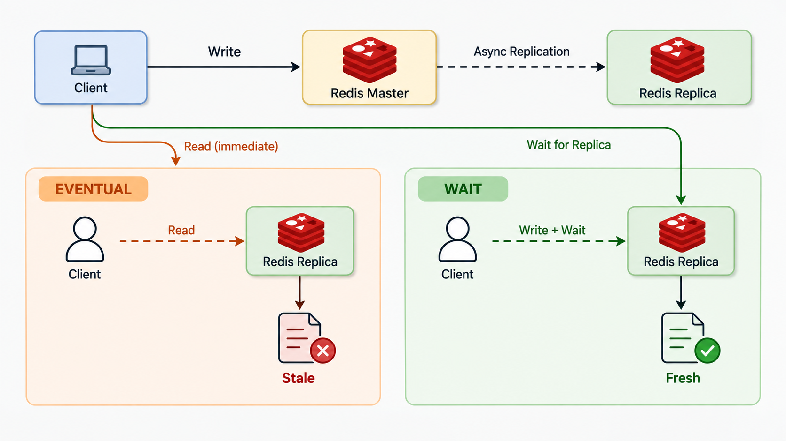
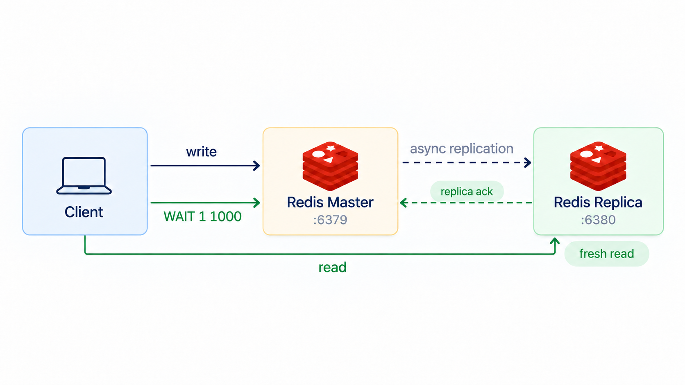
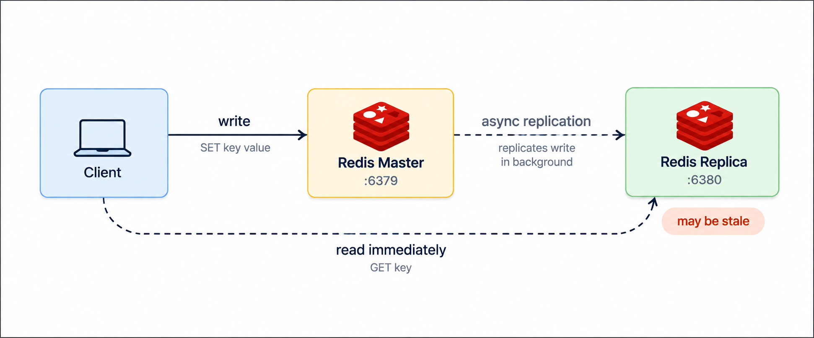
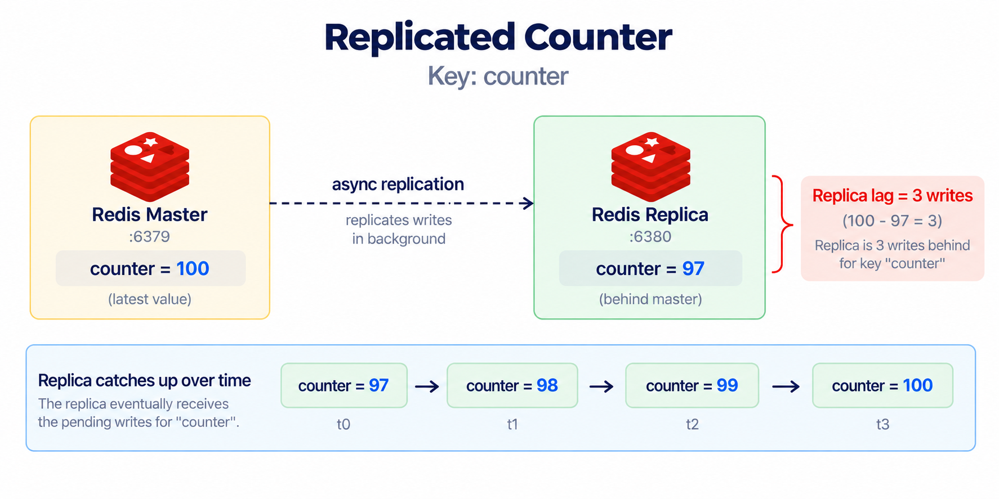
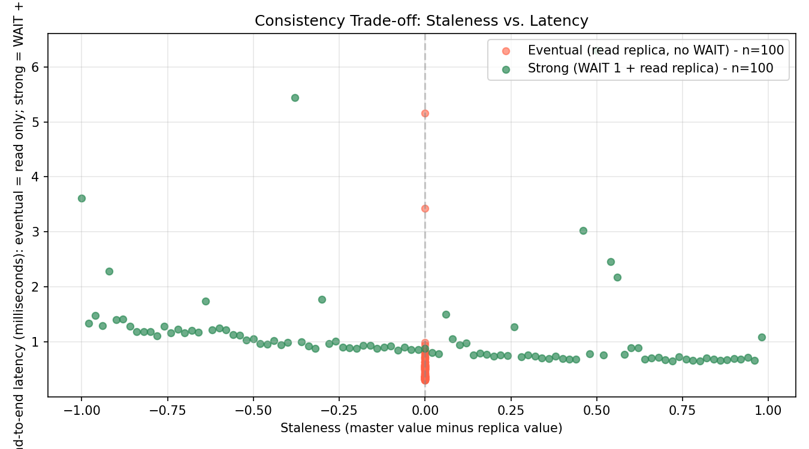

# Consistency Trade-off Explorer

When data lives on more than one node, there is a question every system designer has to answer: **how soon does a write become visible on the other nodes?** The two answers are called **eventual consistency** and **strong consistency**. In this lab we set up a tiny replicated counter in Redis, measure both styles, and draw a chart that shows the trade-off.



Master writes → replica copies, **asynchronously**.

## Objective

- Spin up a Redis master-replica pair with Docker Compose.
- Tell eventual from strong consistency.
- Measure the **divergence window** on a live system.
- Measure **read latency** under each mode.
- Plot staleness vs. read latency.

## Deliverable

A `chart.png` (plus two CSVs) with:

1. **Eventual**: cloud of points, non-zero staleness, low latency.
2. **Strong**: staleness = 0, higher total latency (WAIT + read).

---

## 1. The idea in plain language

Imagine you have one counter (`counter`) that lives on **two** Redis nodes: a **master** (where all writes go) and a **replica** (a copy that follows the master). The replica copies the master in the **background**. That word, "background", is the whole story.



There are two ways for a client to read the counter after writing:

1. **Read from the replica right away.** Fast. But the replica may not have the latest value yet, so the client sees an **old** number. This is **eventual consistency**: "if you wait long enough, the replica will catch up".
2. **Force the master to wait until the replica has the new value, then read.** Now the client always sees the latest number, but the read takes longer because we waited for replication. This is the practical form of **strong consistency** our lab demonstrates: read-your-writes after synchronous replication.

### Definitions

- **Strong consistency (in this lab, read-your-writes).** After a write finishes and `WAIT` returns, the same client's next read returns the new value. We only guarantee this for the writer who waited, not for every other client reading in parallel.



- **Eventual consistency.** Writes spread to other nodes **eventually**. Reads from a node that has not received the latest write return a **stale** value. Nodes converge once writes stop.



- **Divergence window.** How far a replica is behind the master, in writes. If the master is at 100 and the replica is at 97, the divergence is 3.




- **Read latency.** How long a read takes, end-to-end, from request sent to answer received.
- **Atomic (write).** A write that succeeds or fails as one step. `INCR` is atomic: no half-applied increments, even under concurrent clients.

---


### 2.1 What `WAIT` does

`WAIT numreplicas timeout` is a Redis command that blocks the client until at least `numreplicas` replicas have acknowledged **all preceding writes**, or until `timeout` milliseconds pass. We use `WAIT 1 1000`: wait for our one replica, give it up to one second.

`WAIT` is the **switch** we flip to move from eventual to strong consistency in our demo.

---

## 3. Run the following commands in the terminal

Everything in this lab lives in **one folder** (`m2-l3/`) and one README. The README itself contains all the code blocks you need; the next few sections tell you exactly which file each block becomes.

### 3.1 Create the folder and the four files

Open a terminal and run:

```bash
mkdir m2-l3 && cd m2-l3
```

Now create four empty files. On any platform you can do this with `touch`:

```bash
touch docker-compose.yml measure_eventual.py measure_strong.py plot.py
```

In the next section, copy each code block into the file with the matching name. Every block is marked with a header that tells you which file it goes into.

---

## 4. File contents

### 4.1 `docker-compose.yml`

```yaml
# Two Redis nodes: one master, one replica.
# The replica follows the master automatically (asynchronous replication).
# This is the simplest way to demonstrate the difference between
# eventual consistency (read from replica) and strong consistency
# (read from master, or wait for replication to catch up).

services:
  redis-master:
    image: redis:7-alpine
    container_name: redis-master
    # Empty command = default redis-server on default port 6379
    ports:
      - "6379:6379"
    networks:
      - labnet

  redis-replica:
    image: redis:7-alpine
    container_name: redis-replica
    # Tell this Redis to start as a replica of redis-master.
    # replicaof <master-host> <master-port>
    command: redis-server --replicaof redis-master 6379
    ports:
      - "6380:6379"
    networks:
      - labnet

networks:
  labnet:
    driver: bridge
```

**What this file does:**
- Starts two Redis 7 containers on a `labnet` bridge network.
- `redis-master` exposes port `6379` on the host.
- `redis-replica` runs with `--replicaof redis-master 6379` and exposes port `6380`.
- Replication is **asynchronous**: the master replies immediately and ships the change to the replica in the background.

### 4.2 Python dependencies

We need two Python packages: `redis-py` to talk to Redis, and `matplotlib` to draw the chart. Install them with one command (we will run it in section 5.1):

```bash
pip install redis==5.0.1 matplotlib==3.8.2
```

That's the whole "requirements file": one `pip install` line. No separate `requirements.txt` needed.

### 4.3 `measure_eventual.py`

> Copy this block into `measure_eventual.py`.

```python
"""
Eventual-consistency measurement.

Idea:
- We INCR a counter on the master.
- We then read the same key from the REPLICA right away.
- Because replication is asynchronous, the replica is often behind.
- The gap between the master's value and the replica's value
  is the "divergence window" (a.k.a. staleness).
- We also time how long the read takes.

Output:
- results_eventual.csv with columns:
  sample, master_value, replica_value, staleness, read_latency_ms

Run AFTER docker compose up has started both redis containers.
"""

import csv
import time

import redis

MASTER = redis.Redis(host="127.0.0.1", port=6379)
REPLICA = redis.Redis(host="127.0.0.1", port=6380)
KEY = "counter"
SAMPLES = 100


def main() -> None:
    # Reset the counter on both nodes so we start fresh.
    MASTER.delete(KEY)
    # The replica copies the master asynchronously, so a small sleep helps.
    time.sleep(0.1)

    rows = []
    for i in range(SAMPLES):
        # 1) Write to master (INCR is atomic and returns the new value).
        master_value = MASTER.incr(KEY)

        # 2) Immediately read from the replica and time it.
        t0 = time.perf_counter()
        replica_value_raw = REPLICA.get(KEY)
        read_latency_ms = (time.perf_counter() - t0) * 1000.0

        # Replica returns bytes (or None) until the first replication arrives.
        if replica_value_raw is None:
            replica_value = 0
        else:
            replica_value = int(replica_value_raw)

        # 3) Staleness = how far behind the replica is.
        staleness = master_value - replica_value

        rows.append(
            {
                "sample": i + 1,
                "master_value": master_value,
                "replica_value": replica_value,
                "staleness": staleness,
                "read_latency_ms": round(read_latency_ms, 3),
            }
        )

        if (i + 1) % 10 == 0:
            print(
                f"sample {i + 1:3d}: master={master_value} "
                f"replica={replica_value} staleness={staleness} "
                f"latency={read_latency_ms:.2f}ms"
            )

    # Write CSV.
    out = "results_eventual.csv"
    with open(out, "w", newline="") as f:
        writer = csv.DictWriter(
            f,
            fieldnames=[
                "sample",
                "master_value",
                "replica_value",
                "staleness",
                "read_latency_ms",
            ],
        )
        writer.writeheader()
        writer.writerows(rows)

    # Quick summary so the terminal is useful even if the user skips the chart.
    max_stale = max(r["staleness"] for r in rows)
    avg_lat = sum(r["read_latency_ms"] for r in rows) / len(rows)
    print()
    print(f"Wrote {out} with {len(rows)} rows.")
    print(f"Max staleness observed: {max_stale}")
    print(f"Average read latency:    {avg_lat:.2f} ms")


if __name__ == "__main__":
    main()
```

**What this file does:**
- Connects to master (`127.0.0.1:6379`) and replica (`127.0.0.1:6380`).
- Runs 100 samples: `INCR counter` on master, then reads from replica and times it.
- Computes `staleness = master_value - replica_value` per sample.
- Writes one row per sample into `results_eventual.csv`.

### 4.4 `measure_strong.py`

> Copy this block into `measure_strong.py`.

```python
"""
Strong-consistency measurement.

Idea:
- Same counter, same key.
- After INCR on the master we issue `WAIT 1 1000`.
- WAIT blocks the client until the given number of replicas
  have acknowledged the write (or the timeout fires).
- With WAIT 1 1000 we wait for one replica, with up to one second
  to respond. The point is: replication must complete BEFORE we read.
- Then we read from the replica. Staleness should be 0
  every single time.
- We also measure the latency of the read.

Output:
- results_strong.csv with columns:
  sample, master_value, replica_value, staleness,
  wait_ms, read_latency_ms, total_latency_ms, acks

Run AFTER docker compose up has started both redis containers.
"""

import csv
import time

import redis

MASTER = redis.Redis(host="127.0.0.1", port=6379)
REPLICA = redis.Redis(host="127.0.0.1", port=6380)
KEY = "counter"
SAMPLES = 100


def main() -> None:
    # Fresh start.
    MASTER.delete(KEY)
    time.sleep(0.1)

    rows = []
    for i in range(SAMPLES):
        # 1) INCR on master.
        master_value = MASTER.incr(KEY)

        # 2) Force replication: WAIT 1 replica, 1000 ms timeout.
        #    Redis blocks here until the replica has acked this write.
        t_wait_start = time.perf_counter()
        acks = MASTER.execute_command("WAIT", 1, 1000)
        wait_ms = (time.perf_counter() - t_wait_start) * 1000.0

        # 3) Read from replica and time it.
        t0 = time.perf_counter()
        replica_value_raw = REPLICA.get(KEY)
        read_latency_ms = (time.perf_counter() - t0) * 1000.0

        replica_value = (
            0 if replica_value_raw is None else int(replica_value_raw)
        )

        staleness = master_value - replica_value

        # Total latency the client actually paid = WAIT + read.
        total_ms = wait_ms + read_latency_ms

        rows.append(
            {
                "sample": i + 1,
                "master_value": master_value,
                "replica_value": replica_value,
                "staleness": staleness,
                "wait_ms": round(wait_ms, 3),
                "read_latency_ms": round(read_latency_ms, 3),
                "total_latency_ms": round(total_ms, 3),
                "acks": int(acks),
            }
        )

        if (i + 1) % 10 == 0:
            print(
                f"sample {i + 1:3d}: master={master_value} "
                f"replica={replica_value} staleness={staleness} "
                f"wait={wait_ms:.2f}ms read={read_latency_ms:.2f}ms "
                f"acks={acks}"
            )

    out = "results_strong.csv"
    with open(out, "w", newline="") as f:
        writer = csv.DictWriter(
            f,
            fieldnames=[
                "sample",
                "master_value",
                "replica_value",
                "staleness",
                "wait_ms",
                "read_latency_ms",
                "total_latency_ms",
                "acks",
            ],
        )
        writer.writeheader()
        writer.writerows(rows)

    max_stale = max(r["staleness"] for r in rows)
    avg_total = sum(r["total_latency_ms"] for r in rows) / len(rows)
    avg_wait = sum(r["wait_ms"] for r in rows) / len(rows)
    print()
    print(f"Wrote {out} with {len(rows)} rows.")
    print(f"Max staleness observed: {max_stale} (expect 0 with WAIT)")
    print(f"Average wait time:      {avg_wait:.2f} ms")
    print(f"Average total latency:  {avg_total:.2f} ms")


if __name__ == "__main__":
    main()
```

**What this file does:**
- Same loop as `measure_eventual.py`, with `WAIT 1 1000` after `INCR` to force replication.
- Records `wait_ms`, `read_latency_ms`, and `total_latency_ms = wait_ms + read_latency_ms` per sample.
- `staleness` is **0** for every sample because `WAIT` blocks until the replica has caught up.

### 4.5 `plot.py`

> Copy this block into `plot.py`.

```python
"""
Build the consistency trade-off chart.

Reads:
  - results_eventual.csv
  - results_strong.csv

Draws a scatter plot:
  - X axis: staleness (master - replica)
  - Y axis: read latency in milliseconds
  - Two series: eventual (red) and strong (green)

For the eventual series, each sample has its own (staleness, latency).
For the strong series, staleness should always be 0; we jitter a tiny
amount on the X-axis so points are still visible.
"""

import csv
import matplotlib.pyplot as plt


def load(path: str) -> list[dict]:
    with open(path, newline="") as f:
        return list(csv.DictReader(f))


def to_float(rows: list[dict], key: str) -> list[float]:
    return [float(r[key]) for r in rows]


def main() -> None:
    eventual = load("results_eventual.csv")
    strong = load("results_strong.csv")

    ev_stale = to_float(eventual, "staleness")
    ev_lat = to_float(eventual, "read_latency_ms")

    st_stale = to_float(strong, "staleness")
    # Strong mode has both wait_ms and read_latency_ms; total is the
    # honest number a client sees end-to-end.
    st_total = [float(r["wait_ms"]) + float(r["read_latency_ms"]) for r in strong]

    fig, ax = plt.subplots(figsize=(9, 5))

    # Eventual: a cloud of points - some stale, all fast.
    ax.scatter(
        ev_stale,
        ev_lat,
        color="tomato",
        alpha=0.6,
        label=f"Eventual (read replica, no WAIT) - n={len(ev_stale)}",
        s=30,
    )

    # Strong: staleness should be 0 - jitter slightly so dots are visible.
    # We jitter on X by a tiny random amount so the points do not stack
    # into a single vertical line.
    jittered_x = [x + (i - len(st_stale) / 2) * 0.02 for i, x in enumerate(st_stale)]
    ax.scatter(
        jittered_x,
        st_total,
        color="seagreen",
        alpha=0.7,
        label=f"Strong (WAIT 1 + read replica) - n={len(st_stale)}",
        s=30,
    )

    ax.set_xlabel("Staleness (master value minus replica value)")
    ax.set_ylabel("End-to-end latency (milliseconds): eventual = read only; strong = WAIT + read")
    ax.set_title("Consistency Trade-off: Staleness vs. Latency")
    ax.grid(True, alpha=0.3)
    ax.legend(loc="upper right")

    # A vertical guide at staleness = 0 to make the strong column obvious.
    ax.axvline(x=0, color="grey", linestyle="--", alpha=0.4)

    plt.tight_layout()
    plt.savefig("chart.png", dpi=150)
    print("Saved chart.png")

    # Quick terminal summary so the lab is useful without opening the image.
    ev_max_stale = max(ev_stale)
    ev_avg_lat = sum(ev_lat) / len(ev_lat)
    st_max_stale = max(st_stale)
    st_avg_lat = sum(st_total) / len(st_total)

    print()
    print("== Summary ==")
    print(f"Eventual: max staleness = {ev_max_stale}, avg latency = {ev_avg_lat:.2f} ms")
    print(f"Strong:   max staleness = {st_max_stale}, avg latency = {st_avg_lat:.2f} ms")


if __name__ == "__main__":
    main()
```

**What this file does:**
- Reads both CSVs and plots each sample as (staleness, latency).
- Red dots: eventual. Green dots: strong.
- Saves `chart.png` and prints a one-line summary per mode.

---

## 5. Bring everything up

### 5.1 Install Python dependencies

You should already be inside `m2-l3/`. Create a virtual environment (optional but tidy) and install the two packages:

```bash
python3 -m venv .venv
source .venv/bin/activate     # Windows PowerShell: .venv\Scripts\Activate.ps1
pip install redis==5.0.1 matplotlib==3.8.2
```

Verify:

```bash
python -c "import redis, matplotlib; print(redis.__version__, matplotlib.__version__)"
```

### 5.2 Bring up the Redis pair

```bash
docker compose up -d
docker compose ps
```

**Expected:**

```
NAME            STATUS          PORTS
redis-master    Up              0.0.0.0:6379->6379/tcp
redis-replica   Up              0.0.0.0:6380->6379/tcp
```

Confirm the replica really sees the master:

```bash
docker exec redis-replica redis-cli ROLE
```

You should see something like:

```
1) "replica"
2) "127.0.0.1"
3) 6379
...
```

The word `replica` and port `6379` confirm the replica is following the master.

### 5.3 Measure eventual consistency

```bash
python measure_eventual.py
```

**Expected tail of output:**

```
sample 100: master=100 replica=100 staleness=0 latency=0.41ms

Wrote results_eventual.csv with 100 rows.
Max staleness observed: 6
Average read latency:    0.55 ms
```

**What to expect on the way:**
- Early samples may show `replica=0` and high `staleness` until the replica catches up.
- Later samples mostly hit `staleness=0`, with occasional small positive values (1-5).
- `read_latency_ms` is sub-millisecond; replica and master are on the same host.

### 5.4 Measure strong consistency

```bash
python measure_strong.py
```

**Expected tail of output:**

```
sample 100: master=100 replica=100 staleness=0 wait=0.30ms read=0.40ms acks=1

Wrote results_strong.csv with 100 rows.
Max staleness observed: 0 (expect 0 with WAIT)
Average wait time:      0.32 ms
Average total latency:  0.72 ms
```

**What to expect:**
- `staleness` is **0** for every sample; `WAIT` blocks the read until replication is done.
- `wait_ms` is small but **not zero**: the cost of the consistency guarantee.
- `acks=1` means the master got an ack from the replica.
- `total_latency_ms` (`wait_ms + read_latency_ms`) is consistently higher than the eventual mode's read latency.

### 5.5 Plot the chart

```bash
python plot.py
```

**Expected:**

```
Saved chart.png

== Summary ==
Eventual: max staleness = 6, avg latency = 0.55 ms
Strong:   max staleness = 0, avg latency = 0.72 ms
```

Open `chart.png`:



**How to read it:**
- **X axis (staleness):** how far the replica lags the master. `0` means up-to-date.
- **Y axis (end-to-end latency):** how long the client waited, in milliseconds. For eventual mode this is just the read; for strong mode it is `WAIT + read`.
- **Red dots (eventual):** scattered to the right (some samples were stale) and low on the Y axis (very fast reads).
- **Green dots (strong):** all sitting on the line `staleness = 0` (jittered a little so dots do not overlap), and a bit higher on the Y axis because of the `WAIT` cost.
- The vertical dashed line at `x = 0` is a guide for the eye.

### 5.6 Tear down

When you are done:

```bash
docker compose down
```

---

## 6. The numbers behind the chart

| Mode   | Staleness behaviour              | Where the latency comes from           | User experience |
| ------ | -------------------------------- | -------------------------------------- | --------------- |
| Eventual | Up to "N" writes behind the master | Just the network round-trip to the replica | Fast reads, can see old numbers |
| Strong (read-your-writes) | Always 0 for the waiting writer | `WAIT` for replication + the read round-trip | Slower reads, but the writer always sees its own write |

`N` is non-zero and grows with network jitter and load; in our loop writes are back-to-back, so `N` stays in single digits.

---

## 7. When to pick which

- **Pick eventual** when stale reads are OK and you want speed: view counters, like counts, social feeds, product catalogues that change rarely.
- **Pick strong** when stale reads would break an invariant: bank balances, inventory counts, seat reservations, anything where two users acting at the same time must see the same answer.

This is the trade-off the chart is drawing. Strong consistency removes staleness by **adding** latency. Eventual consistency removes latency by **allowing** staleness.

---

## 8. Conclusion

We built a small replicated counter on Redis, measured the divergence window between master and replica under eventual consistency, and measured the extra latency that `WAIT` adds when the writer waits for synchronous replication. The chart shows the trade-off in one picture: red points are fast but sometimes stale, green points are always fresh for the waiting writer but a little slower.

In real systems the choice is rarely "all eventual" or "all strong". Most production designs pick **per-key** or **per-query**: strong for money and inventory, eventual for feeds and counters. This lab gives you the tool to **see** what that trade-off actually looks like on a live system.