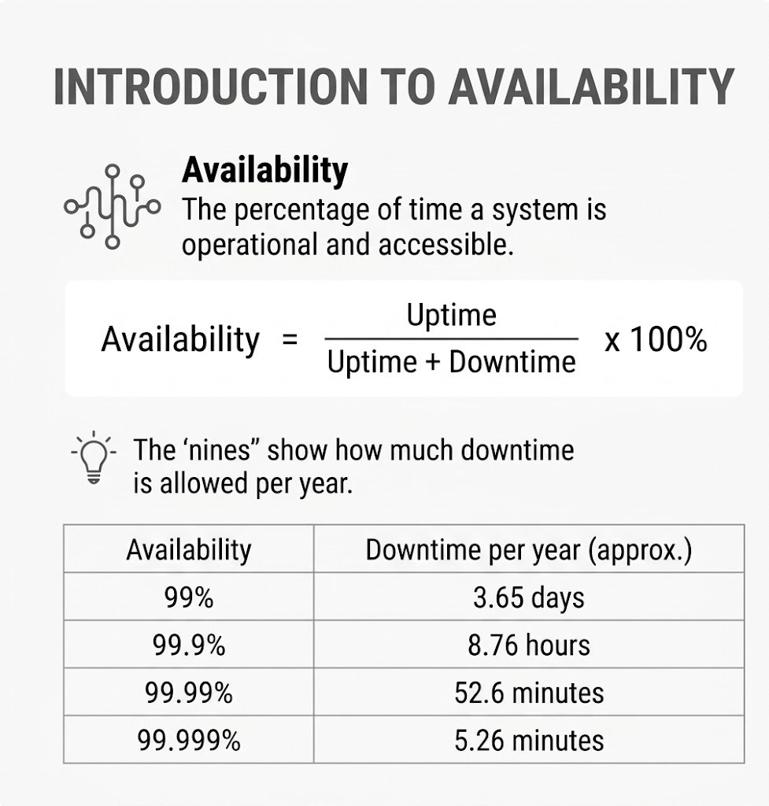
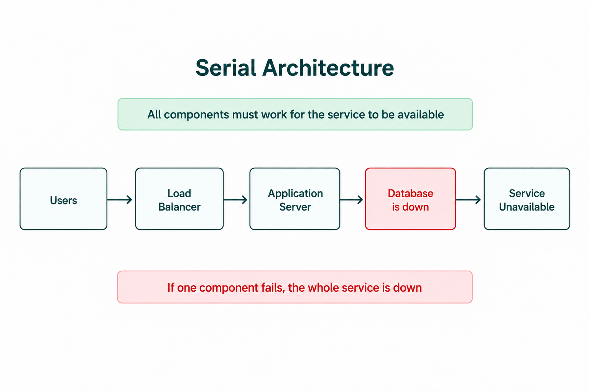
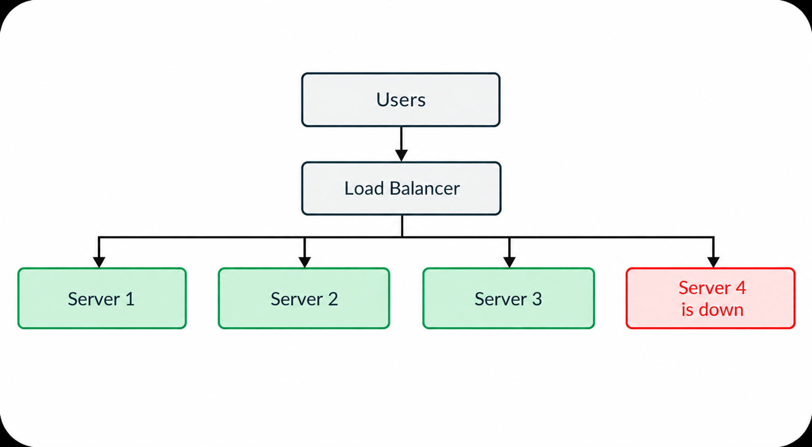
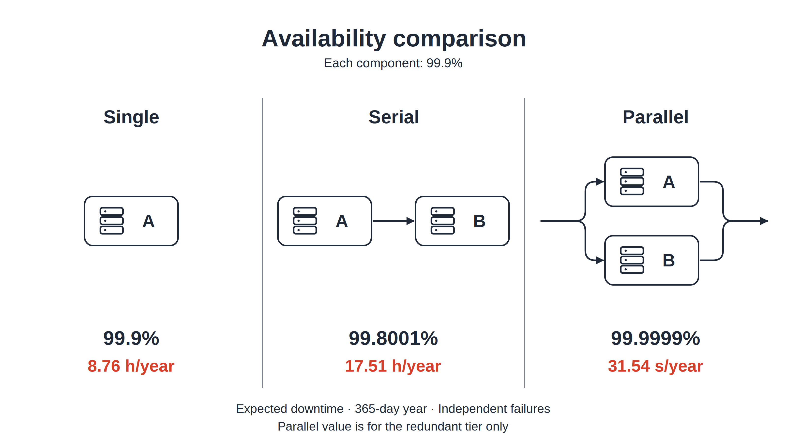
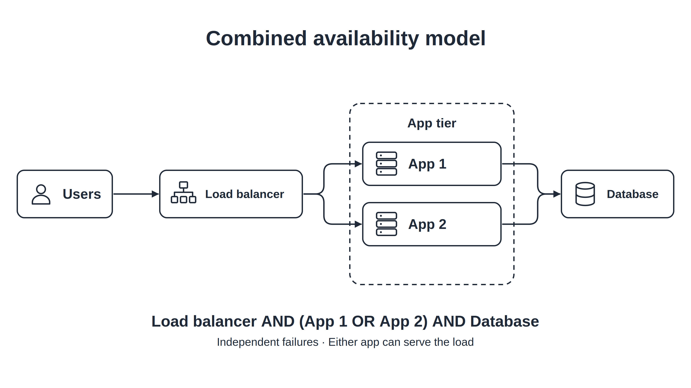
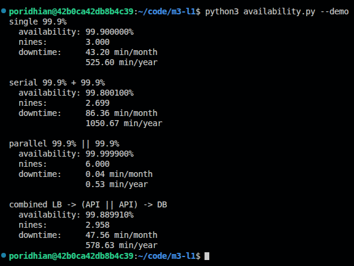
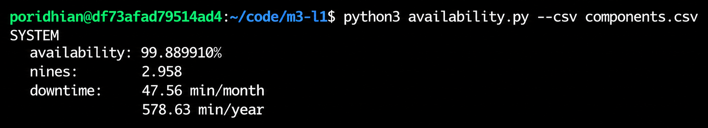
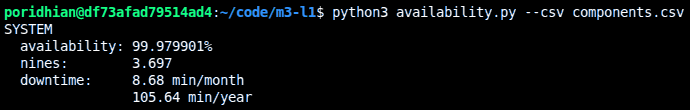

# Availability Math

Imagine your URL shortener has a load balancer, an app server, and a database. Each part works **99.9% of the time**. Will the whole system also work 99.9% of the time?

A successful request needs all three parts. If any required part fails, the user cannot open the short link. Adding another app server helps, but a failed shared database can still stop both apps.

In this lab, you will build a Python calculator to compare these designs and estimate their downtime. **You are calculating a model; you do not need to start real servers.**

<p align="center">
  
</p>

**Read the picture from left to right:** choose how the components connect, calculate their availability, then compare uptime and downtime. In the lower design, A is required and the two B copies are alternatives. If A fails, neither B copy can help.

The lower design is labeled “Parallel” because the B copies form a parallel group. The complete design is combined: `A → (B || B)`. Calculate the B group first, then multiply its availability by A's availability.

## Objective

By the end, you will be able to:

- Explain availability and “nines.”
- Calculate availability when **every component must work** (serial).
- Calculate availability when **at least one copy must work** (parallel).
- Combine both designs and explain the resulting downtime.

## Tools and Deliverable

Use **Python 3.8 or newer**, a terminal, and a text editor. No extra Python packages are needed.

You will create `availability.py` and `components.csv`, then use them to produce an availability report. At the end, write a short comparison of the original design and an improved design.

## 1. Understand Availability and Nines

**Availability** is the fraction of time a service can do its job. If it works for 99 hours and is unavailable for 1 hour:

```text
Availability = uptime / (uptime + downtime)
             = 99 / (99 + 1)
             = 0.99 = 99%
```

“Nines” is shorthand for the number of 9s in the availability percentage. **Three nines means 99.9%.** In a formula, use the decimal `0.999`.

| Nines | Availability | Expected downtime in a 30-day month | Expected downtime in a 365-day year |
| --- | --- | --- | --- |
| 2 | 99% | 432 minutes | 5,256 minutes |
| 3 | 99.9% | 43.2 minutes | 525.6 minutes |
| 4 | 99.99% | 4.32 minutes | 52.56 minutes |
| 5 | 99.999% | 0.432 minutes | 5.256 minutes |

Each extra nine reduces expected downtime **tenfold**. Calculate downtime by multiplying the unavailable fraction by the length of the period:

```text
For 99.9% availability:
Yearly downtime = (1 - 0.999) × 525,600 minutes
                = 525.6 minutes = 8.76 hours
```

This is an estimate over time, not a prediction of when an outage will happen.

## 2. Serial: Every Required Part Must Work

In the URL shortener, the load balancer sends the request to the app, and the app reads the database. All three are required for this request.

<p align="center">
  
</p>

**What is happening?** The request reaches the load balancer, but the app is down. It cannot look up the URL in the database, so the user gets no successful redirect. “Cannot connect” describes the broken request path; the database itself may still be running.

For independent component failures, multiply the availability of the required parts:

```text
System availability = load balancer × app × database
```

Start with just two required parts, A and B, each with three nines:

```text
Serial availability = 0.999 × 0.999
                    = 0.998001 = 99.8001%
```

**Why did availability decrease?** Either part can stop the service. Each required dependency adds another possible failure.

## 3. Parallel: One Working Copy Is Enough

A **replica** is another copy that can do the same job. Two interchangeable app servers form a parallel group.

<p align="center">
  
</p>

**What is happening?** App 2 is down. The load balancer sends the request to App 1, which still works. The app group is unavailable only when **both copies are down**.

Calculate the chance that both fail, then subtract it from one:

```text
Each app availability = 0.999
Each app failure probability = 1 - 0.999 = 0.001

Both fail = 0.001 × 0.001 = 0.000001
App group availability = 1 - 0.000001
                       = 0.999999 = 99.9999%
```

For two copies with availability A and B:

```text
Parallel availability = 1 - (1 - A) × (1 - B)
```

This result describes **the app group**. The shared load balancer remains required: if it fails, users cannot reach either app.

### Compare the results

<p align="center">
  
</p>

All components in the picture have the same 99.9% availability:

- **Single:** one component must work—about 8.76 hours of downtime per year.
- **Serial:** both must work—about 17.51 hours per year.
- **Parallel:** either copy can work—about 31.54 seconds per year for the group.

The connection between components changes the result, even when their individual availability stays the same.

## 4. Combined: Calculate the App Group First

Our lab system combines three required roles: a load balancer, an app group, and a database. A **tier** is a component or group doing one role.

<p align="center">
  
</p>

**Follow a request:** the load balancer chooses one working app, that app reads the database, and the result returns to the user. The request needs **one app**, plus the load balancer and database.

Use three nines for the load balancer and each app, and four nines for the database:

```text
1. Calculate the app group:
   Apps = 1 - (1 - 0.999) × (1 - 0.999) = 0.999999

2. Multiply the required tiers:
   System = LB × Apps × DB
          = 0.999 × 0.999999 × 0.9999
          ≈ 99.889910%
```

The app group has six nines, but the whole system has slightly less than three nines. **Backup apps cannot remove failures in shared dependencies.**

These formulas assume components fail independently, routing sends requests to a healthy copy, and a surviving copy has enough capacity. Two apps on the same failed machine would go down together, so the independent-failure estimate would be too optimistic.

Now build the calculator for this design.

## Step 1: Install Python and Create the Project

In your Ubuntu/Debian lab terminal, install Python 3:

```bash
sudo apt update
sudo apt install -y python3
```

`apt update` refreshes the package list. `apt install` installs Python 3. If Python is already installed, it may report that it is already the newest version.

**Expected:** installation finishes without errors. Then check Python in your terminal:

```bash
python3 --version
```

<p align="center">
  
</p>

**Expected:** `Python 3.8` or newer. The screenshot shows `Python 3.12.3`, which meets the requirement. Your exact version can differ.

Create the folder and two empty files:

```bash
mkdir -p m3-l1 && cd m3-l1
touch availability.py components.csv
ls
```

**Expected:** `ls` lists `availability.py` and `components.csv`. The first two commands normally print nothing when successful.

Keep both files in `m3-l1/`. Run the remaining commands from that folder.

## Step 2: Write the Calculator

Open `availability.py` and paste the complete code below. It converts nines to decimals, applies the serial or parallel formula, and prints availability and downtime.

```python
import argparse
import csv
import math


def probability(nines):
    if not math.isfinite(nines) or not 1 <= nines <= 9:
        raise ValueError("nines must be between 1 and 9")
    return 1 - 10 ** -nines


def serial(values):
    return math.prod(values)


def parallel(values):
    return 1 - math.prod(1 - value for value in values)


def report(label, value):
    downtime = 1 - value
    nines = f"{-math.log10(downtime):.3f}" if downtime else "beyond precision"
    print(label)
    print(f"  availability: {value * 100:.6f}%")
    print(f"  nines:        {nines}")
    print(f"  downtime:     {downtime * 43200:.2f} min/month")
    print(f"                {downtime * 525600:.2f} min/year")
    print()


def read_system(path):
    groups = {}
    with open(path, newline="") as source:
        for row in csv.DictReader(source):
            group = row["group"].strip()
            if not group or not row["component"].strip():
                raise ValueError("component and group must not be empty")
            groups.setdefault(group, []).append(probability(float(row["nines"])))
    if not groups:
        raise ValueError("CSV must contain components")
    return serial(parallel(copies) for copies in groups.values())


def main():
    parser = argparse.ArgumentParser(description="Calculate system availability")
    inputs = parser.add_mutually_exclusive_group(required=True)
    inputs.add_argument("--nines", nargs="+", type=float)
    inputs.add_argument("--csv")
    inputs.add_argument("--demo", action="store_true")
    parser.add_argument("--topology", choices=["serial", "parallel"], default="serial")
    args = parser.parse_args()
    try:
        if args.demo:
            a = probability(3)
            report("single 99.9%", a)
            report("serial 99.9% + 99.9%", serial([a, a]))
            report("parallel 99.9% || 99.9%", parallel([a, a]))
            report("combined LB -> (API || API) -> DB",
                   serial([a, parallel([a, a]), probability(4)]))
        elif args.csv:
            report("SYSTEM", read_system(args.csv))
        else:
            values = [probability(n) for n in args.nines]
            calculate = serial if args.topology == "serial" else parallel
            report(args.topology, calculate(values))
    except (ValueError, KeyError, OSError) as error:
        parser.error(str(error))


if __name__ == "__main__":
    main()
```

**What the main functions do:**

| Function | Job |
| --- | --- |
| `probability(3)` | Converts three nines to `0.999`. |
| `serial()` | Multiplies the availability of all required parts. |
| `parallel()` | Calculates the chance that at least one copy works. |
| `read_system()` | Combines copies within each CSV group, then multiplies the required groups. |
| `report()` | Prints availability, equivalent nines, and downtime. |

## Step 3: Run and Read the Examples

Run the built-in examples:

```bash
python3 availability.py --demo
```

**Expected output:**

<p align="center">
  
</p>

**How to read the report:**

- `availability` is the percentage of time the modeled service works.
- `nines` expresses the same result on the nines scale. `2.958` means slightly less than three nines; it does not mean 99.958%.
- `downtime` is the expected unavailable time in a 30-day month and a 365-day year. The calculator prints **minutes**.
- `||` means alternatives; `->` means required tiers.

The first three results match the comparison diagram. The last result matches the combined diagram: **99.889910%** availability and **578.63 minutes** of yearly downtime, or about **9.64 hours**.

### Try the formulas directly

You can also supply nines yourself. Here are two commands and the results to check:

| What to calculate | Command | Expected availability |
| --- | --- | --- |
| Two required parts, each with three nines | `python3 availability.py --nines 3 3 --topology serial` | `99.800100%` |
| Two interchangeable copies, each with three nines | `python3 availability.py --nines 3 3 --topology parallel` | `99.999900%` |

`--nines 3 3` gives each part three nines. `--topology` tells the calculator whether both must work or either copy is enough. These produce the same serial and parallel reports shown above.

## Step 4: Describe the Diagram in a CSV

A CSV is a plain-text table with commas between columns. Open `components.csv` and paste:

```csv
component,nines,group
LB-1,3,lb
API-server-1,3,api
API-server-2,3,api
DB-primary,4,db
```

This file describes **exactly the combined diagram**—one load balancer, two interchangeable apps, and one database.

| Column | What to enter |
| --- | --- |
| `component` | A name for the component. |
| `nines` | Its nines value: use `3` for 99.9%, not `99.9`. |
| `group` | Its role: `lb`, `api`, or `db`. |

**Same group = alternatives.** Both app rows use `api`, so the calculator treats them as parallel copies. They must be able to do the same job.

**Different groups = required tiers.** The `lb`, `api`, and `db` groups must all work. A group with one component uses that component's availability.

Keep the header `component,nines,group`. You can edit this file in a text editor or export it from a spreadsheet as CSV.

Run the calculator:

```bash
python3 availability.py --csv components.csv
```

**Expected output:**

<p align="center">
  
</p>

**What happened?** It calculated the `api` group first, then multiplied `lb × api × db`. The result matches the last demo report. That match confirms your CSV describes the same design as the diagram.

## Step 5: Improve a Shared Dependency

We already have two app copies. What happens if we improve the shared load balancer?

1. In `components.csv`, change `LB-1,3,lb` to `LB-1,4,lb`.
2. Save the file. Leave both apps and the database unchanged.
3. Run the same command again:

```bash
python3 availability.py --csv components.csv
```

**Expected output:**

<p align="center">
  
</p>

**Compare before and after:**

| Design | Availability | Expected downtime/year |
| --- | --- | --- |
| Original: three-nine load balancer | 99.889910% | 578.63 minutes (about 9.64 hours) |
| Improved: four-nine load balancer | 99.979901% | 105.64 minutes (about 1.76 hours) |

We improved the load balancer's assumed availability from 99.9% to 99.99%. This reduces the whole system's expected downtime because every request depends on it. Editing the CSV changes the **model**; achieving that improvement in a deployed service requires actual engineering work.

**Your task:** write three short sentences explaining what changed, how yearly downtime changed, and why backup apps alone cannot protect against a failed load balancer.

## Step 6: Verify Your Work

- [ ] The demo runs and its serial and parallel results match the comparison diagram.
- [ ] The original CSV result matches the combined demo result.
- [ ] Improving the load balancer reduces expected yearly downtime.
- [ ] I can explain “all parts must work” versus “one copy is enough.”
- [ ] I include shared dependencies when calculating the whole system.
- [ ] I have written my three-sentence comparison.

If you get stuck:

| Problem | What to check |
| --- | --- |
| `python3: command not found` | Install Python 3.8 or newer. If your system uses `python`, check its version and use that command. |
| `can't open file 'availability.py'` | Run from `m3-l1/` and check that the file was saved there. |
| CSV file or column-name error | Check the filename and the exact header `component,nines,group`. |
| `nines must be between 1 and 9` | Enter a nines value such as `3`, rather than `99.9`. |

## Conclusion

You can now turn a system diagram into an availability estimate—and use expected downtime to guide your design decisions.

| Design principle | Key takeaway |
| --- | --- |
| **Every required part matters** | Serial dependencies reduce overall availability because any one can stop a request. |
| **One healthy copy can keep service running** | Parallel replicas improve availability when their failures are independent. |
| **Shared dependencies still matter** | Backup apps cannot protect against a failed load balancer or shared database. |

> **From diagram to decision:** calculate each parallel group first, multiply the required tiers, then compare expected downtime to choose which dependency to improve.

In this lab, improving the load balancer from **three nines to four nines** reduced expected yearly downtime from **9.64 hours to 1.76 hours**. A stronger shared dependency made the whole system more available.
