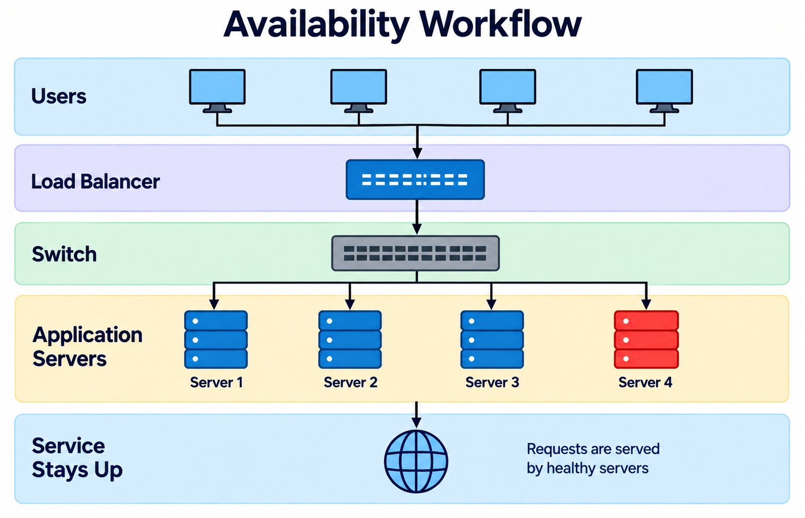

# Availability Math



In system design, people often talk about "nines": 99.9%, 99.99%, or 99.999%. In this lab, you build a Python calculator that turns these numbers into real minutes of downtime. You will see how connecting servers in a line or adding backup copies changes total uptime, and you will find out which server you should fix first.

## Objective

By the end of this lab, you can:
- Turn "nines" and cloud provider uptime numbers into simple decimals.
- Calculate total uptime for servers connected in a single line (serial).
- Calculate total uptime for backup servers running side by side (parallel).
- Model a full system with a simple CSV file.
- Find the weakest server and pick the best place to add a backup copy.

## Tools / Stack

- Python 3 (standard library only: `argparse`, `csv`, `math`)
- A spreadsheet app (Google Sheets, LibreOffice Calc, or Excel) to open CSV files

## Deliverable

A Python script named `availability.py` and a data file named `components.csv`. Together, they calculate total system uptime, show monthly and yearly downtime in minutes and hours, and recommend which component to duplicate to reach an uptime goal.

## Serial Architecture


In a serial system, requests pass through components one after another in a single line. Every component must work for the request to succeed. If the load balancer fails, the application server never gets the request.

Availability multiplies across each component in the line:

```text
A_system = A_1 * A_2 * ... * A_n
```

Because each number is less than 1, a serial chain is always worse than its single weakest part. Adding more servers in a line always lowers your total uptime.

## Parallel Architecture


In a parallel system, backup copies run side by side. The service stays online as long as at least one copy is healthy. 

Total availability is one minus the chance that all copies fail at the same time:

```text
A_system = 1 - (1 - A_1) * (1 - A_2) * ... * (1 - A_n)
```

This is why two cheap servers running side by side often beat one expensive server for uptime. 

Important note: This formula assumes copies fail independently. If two servers share the same power plug or network switch, a single fault can stop both. Keep this in mind when designing real systems.

| Architecture | Formula | What Happens | Example |
| :--- | :--- | :--- | :--- |
| Serial (In a line) | `A1 * A2 * ... * An` | Always worse than weakest part | Two 99.9% servers yield 99.80% |
| Parallel (Side by side) | `1 - (1-A1) * (1-A2)` | Backup copies improve uptime | Two 99.9% servers yield 99.9999% |
| Real System | Line of backup groups | Redundancy shifts the bottleneck | `LB -> (API \|\| API) -> DB` |

---

## Step 1: Create the project folder and files

Start by creating a clean folder and empty files for your work.

```text
m3-l1/
├── availability.py
└── components.csv
```

Run these commands in your terminal:

```bash
mkdir -p m3-l1 && cd m3-l1
touch availability.py components.csv
```

**Explanation:** Creates a new folder named `m3-l1` and makes two empty files inside it.

---

## Step 2: Write the conversion helpers

Humans talk in percentages like "99.9%" or "3 nines", but math formulas need decimal numbers like `0.999`.

```text
User Input ("3 nines", "99.95%") ---> Converter Helpers ---> Math Decimals (0.999, 0.9995)
```

Open `availability.py` and write the conversion functions:

```python
import argparse
import csv
import math

MIN_PER_MONTH = 30 * 24 * 60      # 43200 minutes in a 30-day month
MIN_PER_YEAR = 365 * 24 * 60      # 525600 minutes in a year


def nines_to_prob(nines: float) -> float:
    """Convert nines count to a decimal: 3 -> 0.999, 4 -> 0.9999."""
    if nines < 1 or nines > 9:
        raise ValueError("nines must be between 1 and 9")
    return 1.0 - 10 ** -nines


def percent_to_prob(percent: float) -> float:
    """Convert SLA percentage to a decimal: 99.95 -> 0.9995."""
    if percent <= 0 or percent > 100:
        raise ValueError("percent must be between 0 and 100")
    return percent / 100.0


def prob_to_nines(p: float) -> float:
    """Convert a decimal probability back to nines: 0.999 -> 3.0."""
    if p <= 0 or p >= 1:
        return float("inf")
    return -math.log10(1.0 - p)
```

**What this file does:** Converts human numbers and cloud SLA percentages into clean decimals for math calculations.

---

## Step 3: Add serial and parallel calculation rules

Now implement the two basic rules of uptime math: serial multiplication and parallel redundancy.

```text
Serial:   [ Server 1 ] ---> [ Server 2 ]  =>  A1 * A2
Parallel: [ Server 1 ] ||   [ Server 2 ]  =>  1 - (1 - A1) * (1 - A2)
```

Add these two functions to `availability.py`:

```python
def serial(*probs: float) -> float:
    """Every component must work. Probabilities multiply."""
    out = 1.0
    for p in probs:
        out *= p
    return out


def parallel(*probs: float) -> float:
    """At least one copy must work. Assumes copies fail independently."""
    out = 1.0
    for p in probs:
        out *= (1.0 - p)
    return 1.0 - out
```

**What this file does:** Multiplies probabilities for serial chains and computes backup uptime for parallel tiers.

---

## Step 4: Add downtime report formatting

A decimal like `0.999` is hard to imagine. Engineers prefer to know how many minutes the system will be down per month and per year.

```text
Decimal Uptime (0.999) ---> Calculate Downtime ---> 43.20 min/month, 8.8 hours/year
```

Add these reporting helpers to `availability.py`:

```python
def fmt_downtime(minutes: float, per: str) -> str:
    """Show downtime in minutes, and add hours in parentheses if over 60."""
    if minutes >= 60:
        return f"{minutes:.2f} min/{per}  ({minutes / 60:.1f} hours)"
    return f"{minutes:.2f} min/{per}"


def report(label: str, p: float) -> None:
    """Print clean report with percentage, nines, and downtime."""
    nines = prob_to_nines(p)
    nines_txt = "9+ (beyond precision)" if math.isinf(nines) else f"{nines:.3f}"
    print(label)
    print(f"  availability: {p * 100:.6f}%")
    print(f"  nines:        {nines_txt}")
    print(f"  downtime:     {fmt_downtime(MIN_PER_MONTH * (1 - p), 'month')}")
    print(f"                {fmt_downtime(MIN_PER_YEAR * (1 - p), 'year')}")
    print()
```

**What this file does:** Formats uptime decimals into clear downtime numbers in minutes and hours.

---

## Step 5: Test basic math with a demo function

Before reading real files, add a demo function to compare a single server, a serial line, a parallel pair, and a small combined system.

```text
Single (99.9%)  vs  Serial (99.8%)  vs  Parallel (99.9999%)  vs  Combined System (99.88%)
```

Add this function to `availability.py`:

```python
def demo() -> None:
    """Run four clear examples to verify the math."""
    a = nines_to_prob(3)
    report("single 99.9%", a)
    report("serial   99.9% + 99.9%", serial(a, a))
    report("parallel 99.9% || 99.9%", parallel(a, a))

    # A real mini system: Load Balancer -> Two API Servers -> Database
    lb = nines_to_prob(3)
    api = parallel(nines_to_prob(3), nines_to_prob(3))
    db = nines_to_prob(4)
    report("combined LB -> (API || API) -> DB", serial(lb, api, db))
```

**What this file does:** Runs sample cases so you can see how serial chains drop uptime while backup copies improve it.

---

## Step 6: Describe your real system in a CSV file

Real systems have multiple tiers. In a CSV file, components sharing the same group name act as backup copies in parallel. Different groups connect in series.

```text
[LB (Group: lb)] ---> [(API-1 || API-2) (Group: api)] ---> [DB (Group: db)] ---> [Cache (Group: cache)]
```

Open `components.csv` and write your system components:

```csv
component,nines,group
LB-1,3,lb
API-server-1,3,api
API-server-2,3,api
DB-primary,4,db
Cache,3,cache
```

**What this file does:** Lists each component, its uptime rating, and its group name.

---

## Step 7: Load CSV and compute total system uptime

To calculate the whole system, combine backup copies in each group first, then multiply the groups together.

```text
Read CSV Groups ---> Combine Parallel Backups ---> Multiply Serial Groups ---> Overall Uptime
```

Add these functions to `availability.py`:

```python
def load_groups(path: str) -> dict:
    """Read components.csv into a dictionary of groups."""
    groups: dict = {}
    with open(path, newline="") as fh:
        for row in csv.DictReader(fh):
            name = row["component"].strip()
            group = row["group"].strip()
            if not name or not group:
                continue
            nines = float(row["nines"])
            groups.setdefault(group, []).append(nines_to_prob(nines))
    if not groups:
        raise ValueError(f"no usable rows in {path}")
    return groups


def system_availability(groups: dict) -> float:
    """Combine parallel copies in each group, then chain all groups in series."""
    tier_probs = [parallel(*copies) for copies in groups.values()]
    return serial(*tier_probs)


def report_groups(groups: dict) -> float:
    """Print the uptime for each tier and the total system uptime."""
    print("Tier breakdown")
    for name, copies in groups.items():
        tier = parallel(*copies)
        shape = f"{len(copies)} copies in parallel" if len(copies) > 1 else "single"
        print(f"  {name:<12} {tier * 100:11.6f}%   ({shape})")
    print()
    total = system_availability(groups)
    report("SYSTEM", total)
    return total
```

**What this file does:** Reads your CSV file, groups redundant servers, and calculates overall system uptime.

---

## Step 8: Add the smart recommendation helper

When your manager asks for 99.95% uptime, where should you spend money? This helper tests adding one backup copy to each tier and picks the one that gives the biggest jump in uptime.

```text
Goal (99.95%) ---> Test +1 to Each Tier ---> Pick Biggest Gain ---> Repeat Until Goal Is Met
```

Add this helper to `availability.py`:

```python
def suggest_for_target(groups: dict, target_percent: float,
                       max_adds: int = 6) -> None:
    """Find the best component to duplicate step by step."""
    target = percent_to_prob(target_percent)
    current = system_availability(groups)
    print(f"Target:  {target_percent}%")
    print(f"Current: {current * 100:.6f}%")

    if current >= target:
        print("Already meeting the target. No change needed.\n")
        return

    print("\nEffect of adding one more copy to each tier:")
    for name, copies in groups.items():
        trial = {k: list(v) for k, v in groups.items()}
        trial[name].append(max(copies))
        new = system_availability(trial)
        gain = prob_to_nines(new) - prob_to_nines(current)
        print(f"  +1 {name:<12} -> {new * 100:11.6f}%   (+{gain:.3f} nines)")

    plan, work = [], {k: list(v) for k, v in groups.items()}
    for _ in range(max_adds):
        best_name, best_val = None, system_availability(work)
        for name, copies in work.items():
            trial = {k: list(v) for k, v in work.items()}
            trial[name].append(max(copies))
            val = system_availability(trial)
            if val > best_val:
                best_name, best_val = name, val
        if best_name is None:
            break
        work[best_name].append(max(work[best_name]))
        plan.append(best_name)
        if best_val >= target:
            break

    final = system_availability(work)
    print("\nCheapest plan found:")
    if final >= target:
        for i, name in enumerate(plan, 1):
            print(f"  {i}. add one copy of '{name}'")
        print(f"  -> {final * 100:.6f}%  TARGET MET")
    else:
        print(f"  {max_adds} extra copies only reach {final * 100:.6f}%.")
        print("  Weakest tier needs a better machine, not just more duplicates.")
    print()
```

**What this file does:** Finds the most cost-effective servers to duplicate to hit your target uptime.

---

## Step 9: Add command line arguments and entry point

Allow running the script with flags from the terminal.

```text
Terminal Command (--demo, --csv, --nines, --target) ---> main() ---> Output
```

Append the `main` block to the end of `availability.py`:

```python
def main() -> None:
    ap = argparse.ArgumentParser(description="System availability calculator")
    ap.add_argument("--csv", help="path to components.csv")
    ap.add_argument("--nines", nargs="+", type=float,
                    help="component nines, e.g. --nines 3 3 4")
    ap.add_argument("--topology", choices=["serial", "parallel"], default="serial")
    ap.add_argument("--target", type=float,
                    help="target availability percent, e.g. 99.95")
    ap.add_argument("--demo", action="store_true", help="run the worked examples")
    args = ap.parse_args()

    if args.csv:
        groups = load_groups(args.csv)
        report_groups(groups)
        if args.target:
            suggest_for_target(groups, args.target)
    elif args.nines:
        probs = [nines_to_prob(n) for n in args.nines]
        fn = serial if args.topology == "serial" else parallel
        report(f"{len(probs)} components in {args.topology}", fn(*probs))
    else:
        demo()


if __name__ == "__main__":
    main()
```

**What this file does:** Reads terminal options so you can run sample demos, quick chain tests, or load CSV files.

---

## 10. Run the following commands in the terminal

Now run your calculator across the four main scenarios.

```bash
# 1. Run the sample demo comparisons
python3 availability.py --demo

# 2. Test a quick serial line of three 3-nines components
python3 availability.py --nines 3 3 4 --topology serial

# 3. Test two 3-nines backup components side by side
python3 availability.py --nines 3 3 --topology parallel

# 4. Check your real system from CSV and get advice to reach 99.95%
python3 availability.py --csv components.csv --target 99.95
```


**What to expect:** The demo prints availability percentages, nines, and downtime for single, serial, parallel, and combined setups. For `components.csv`, it shows an uptime of 99.790020% (about 18.4 hours of downtime per year) and suggests adding one backup copy of `lb` and one of `cache` to hit 99.95%.

| Nines | Availability | Downtime per Month | Downtime per Year |
| :--- | :--- | :--- | :--- |
| 2 nines | 99.0% | 432.00 min (7.2 hours) | 5256.00 min (3.65 days) |
| 3 nines | 99.9% | 43.20 min | 525.60 min (8.8 hours) |
| 4 nines | 99.99% | 4.32 min | 52.56 min |
| 5 nines | 99.999% | 0.43 min (26 seconds) | 5.26 min |

## Verification checklist

- [ ] `python3 availability.py --demo` runs cleanly and prints four sample comparisons.
- [ ] Serial uptime (99.8001%) computes lower than a single component (99.9%).
- [ ] Parallel uptime (99.9999%) computes higher than a single component (99.9%).
- [ ] `python3 availability.py --csv components.csv` reads all groups and shows total system uptime.
- [ ] Running with `--target 99.95` recommends duplicating `lb` and `cache`.

## Exercises

1. **Test the limit:** Run the script with `--target 99.9999`. Notice why adding copies of other servers never reaches six nines as long as the database remains a single 4-nines server.
2. **Remove the cache:** Delete the `Cache` line from `components.csv` and re-run. Notice that removing a serial component actually raises total uptime because fewer things can break.
3. **Shared failures:** Both API servers sit behind a single load balancer. If that load balancer breaks, both servers become unreachable. Explain why the load balancer must sit outside the parallel group.

## Conclusion

You built a working calculator that turns system design numbers into real minutes of downtime. You learned why servers in a line lower uptime, how backup copies protect against failures, and how to spot the weakest server in your architecture. In the next lab, you will use these formulas to design systems that handle automatic failover when a server goes down.