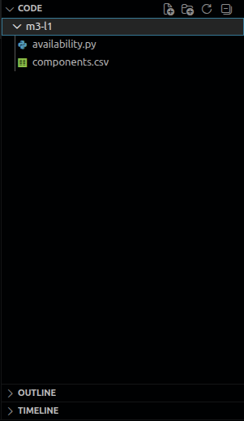
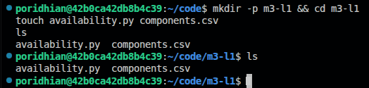

# Availability Math

<p align="center">
  <a href="./images/availability.png">
    
  </a>
</p>

Build a Python calculator for a URL shortener with a load balancer, app servers, and a database. Compare designs and estimate how long each might be unavailable. This lab calculates a model; it does not start servers.

## Objective

By the end of this lab, you can:

- Explain availability and nines.
- Calculate availability for required parts and alternative copies.
- Estimate downtime and improve a shared dependency.

## Deliverable

<p align="center">
  <a href="./images/create-file.png">
    
  </a>
</p>

A calculator in `availability.py` and a system description in `components.csv`. The final CSV uses a four-nine load balancer, two three-nine apps, and a four-nine database.

## Understand Availability and Nines

<p align="center">
  <a href="./images/availability-calculation-result.png">
    
  </a>
</p>

**Availability** is the fraction of time a service can do its job: uptime divided by total time. **Nines** counts the 9s in its percentage. Three nines means 99.9%, written as `0.999` in formulas.

| Nines | Availability | Downtime per 30-day month | Downtime per 365-day year |
| --- | --- | --- | --- |
| 2 | 99% | 432 minutes | 5,256 minutes |
| 3 | 99.9% | 43.2 minutes | 525.6 minutes |
| 4 | 99.99% | 4.32 minutes | 52.56 minutes |
| 5 | 99.999% | 0.432 minutes | 5.256 minutes |

Each extra nine reduces expected downtime tenfold. Multiply the unavailable fraction by the period length: `(1 - 0.999) * 525600 = 525.6` minutes per year. These are estimates, not outage schedules.

## Serial: Every Part Must Work

<p align="center">
  <a href="./images/serial.png">
    
  </a>
</p>

A load balancer directs requests to an app, which reads the database. All three are required. Multiply their availabilities when failures are independent.

For two required three-nine parts, `0.999 * 0.999 = 0.998001`, or **99.8001%**. Either part can stop the service. A broken path does not mean every component has stopped.

## Parallel: One Copy Is Enough

<p align="center">
  <a href="./images/parallel.png">
    
  </a>
</p>

A **replica** is another copy that can do the same job. A parallel group works when at least one copy works. Calculate the chance that all copies fail, then subtract it from one.

Two three-nine copies give `1 - (1 - 0.999) * (1 - 0.999) = 0.999999`, or **99.9999%**. This result covers the app group; the shared load balancer is still required.

## Combined: Calculate the App Group First

<p align="center">
  <a href="./images/combine.png">
    
  </a>
</p>

A **tier** is a component or group doing one role. Calculate the parallel app tier, then multiply the required tiers: `LB * Apps * DB`. Using three nines for the load balancer and apps, and four for the database, gives **99.889910%**.

These formulas assume independent failures, routing to healthy copies, and enough capacity in a surviving copy. Two apps on one failed machine would fail together. Backup apps cannot remove failures in shared dependencies.

## Step 1: Create the Project

<p align="center">
  <a href="./images/python-install.png">
    
  </a>
</p>

Use an Ubuntu/Debian terminal with Python 3.8 or newer. Install Python if needed:

```bash
sudo apt update
sudo apt install -y python3
python3 --version
```

**Explanation:** Refreshes package information, installs Python, and prints its version.

**Command results:** `apt update` prints repository information. `apt install` reports installation progress or says Python is already installed. `python3 --version` prints one line, such as `Python 3.12.3` in the screenshot; any version from 3.8 onward works here.

<p align="center">
  <a href="./images/file-command.png">
    
  </a>
</p>

Create the folder and empty files:

```bash
mkdir -p m3-l1 && cd m3-l1
touch availability.py components.csv
ls
```

**Explanation:** Creates the project and lists `availability.py` and `components.csv`.

**Command results:** `mkdir`, `cd`, and `touch` normally print nothing when successful. `ls` lists `availability.py` and `components.csv`, as shown in `file-command.png`. The prompt changes to `m3-l1`, showing that the terminal is inside the project folder. The editor view in `create-file.png` shows the same files.

Open `m3-l1` in your editor. Both files are empty until you add their contents.

---

## Step 2: Write the Calculator

<p align="center">
  <a href="./images/demo-output.png">
    
  </a>
</p>

Paste this complete code into `availability.py`. It uses only Python's built-in libraries.

```python
import argparse
import csv
import math


def probability(nines):
    if not math.isfinite(nines) or not 1 <= nines <= 9:
        raise ValueError("nines must be between 1 and 9")
    return 1 - 10 ** -nines


def serial(values):
    return math.prod(values)


def parallel(values):
    return 1 - math.prod(1 - value for value in values)


def report(label, value):
    downtime = 1 - value
    nines = f"{-math.log10(downtime):.3f}" if downtime else "beyond precision"
    print(label)
    print(f"  availability: {value * 100:.6f}%")
    print(f"  nines:        {nines}")
    print(f"  downtime:     {downtime * 43200:.2f} min/month")
    print(f"                {downtime * 525600:.2f} min/year")
    print()


def read_system(path):
    groups = {}
    with open(path, newline="") as source:
        for row in csv.DictReader(source):
            group = row["group"].strip()
            if not group or not row["component"].strip():
                raise ValueError("component and group must not be empty")
            groups.setdefault(group, []).append(probability(float(row["nines"])))
    if not groups:
        raise ValueError("CSV must contain components")
    return serial(parallel(copies) for copies in groups.values())


def main():
    parser = argparse.ArgumentParser(description="Calculate system availability")
    inputs = parser.add_mutually_exclusive_group(required=True)
    inputs.add_argument("--nines", nargs="+", type=float)
    inputs.add_argument("--csv")
    inputs.add_argument("--demo", action="store_true")
    parser.add_argument("--topology", choices=["serial", "parallel"], default="serial")
    args = parser.parse_args()
    try:
        if args.demo:
            a = probability(3)
            report("single 99.9%", a)
            report("serial 99.9% + 99.9%", serial([a, a]))
            report("parallel 99.9% || 99.9%", parallel([a, a]))
            report("combined LB -> (API || API) -> DB",
                   serial([a, parallel([a, a]), probability(4)]))
        elif args.csv:
            report("SYSTEM", read_system(args.csv))
        else:
            values = [probability(n) for n in args.nines]
            calculate = serial if args.topology == "serial" else parallel
            report(args.topology, calculate(values))
    except (ValueError, KeyError, OSError) as error:
        parser.error(str(error))


if __name__ == "__main__":
    main()
```

**What this file does:** Converts nines to availability, combines components, and prints expected downtime.

| Function | Job |
| --- | --- |
| `probability()` | Converts nines to a decimal |
| `serial()` | Multiplies required parts |
| `parallel()` | Combines alternative copies |
| `read_system()` | Groups CSV components by role |
| `report()` | Prints availability and downtime |

---

## Step 3: Write the System CSV

<p align="center">
  <a href="./images/combine.png">
    
  </a>
</p>

A **CSV** is a text table with comma-separated columns. Paste this into `components.csv`:

```csv
component,nines,group
LB-1,3,lb
API-server-1,3,api
API-server-2,3,api
DB-primary,4,db
```

**What this file does:** Describes one required load balancer, two alternative apps, and one required database.

Rows in the same group are alternatives. Different groups are required tiers. Keep the header, and enter `3` for three nines, not `99.9`.

---

## Step 4: Run the Following Commands in the Terminal

<p align="center">
  <a href="./images/demo-output.png">
    
  </a>
</p>

Run these commands from `m3-l1` after saving both files:

```bash
python3 availability.py --demo
python3 availability.py --nines 3 3 --topology serial
python3 availability.py --nines 3 3 --topology parallel
python3 availability.py --csv components.csv
```

**Explanation:** Runs the demo, two direct calculations, and the CSV system model.

**Read each command's result:**

| Command option | Output heading | Meaning |
| --- | --- | --- |
| `--demo` | Four labeled reports | Compares single, serial, parallel, and combined designs |
| `--nines 3 3 --topology serial` | `serial` | Both three-nine parts must work |
| `--nines 3 3 --topology parallel` | `parallel` | Either three-nine copy can work |
| `--csv components.csv` | `SYSTEM` | Uses the groups saved in your CSV |

In `demo-output.png`, each report prints availability, equivalent nines, and downtime for a 30-day month and 365-day year. The parallel report rounds yearly downtime to `0.53` minutes, about 31.54 seconds before rounding. The combined result is lower because the load balancer and database remain required.

<p align="center">
  <a href="./images/csv-system-output.png">
    
  </a>
</p>

**What to expect:** The original CSV matches the combined demo. The report uses minutes for downtime. A nines value of `2.958` means slightly less than three nines, not 99.958%.

| Design | Availability | Yearly downtime |
| --- | --- | --- |
| Single three-nine part | 99.9% | 525.60 minutes |
| Two required parts | 99.800100% | 1050.67 minutes |
| Two alternative copies | 99.999900% | 0.53 minutes |
| Combined original CSV | 99.889910% | 578.63 minutes |

---

## Step 5: Improve the Load Balancer

<p align="center">
  <a href="./images/improved-lb-output.png">
    
  </a>
</p>

Replace `components.csv` with this complete file to give the load balancer four nines:

```csv
component,nines,group
LB-1,4,lb
API-server-1,3,api
API-server-2,3,api
DB-primary,4,db
```

**What this file does:** Improves the load balancer's assumed availability while keeping the apps and database unchanged.

After saving the improved CSV, run this command from `m3-l1`:

```bash
python3 availability.py --csv components.csv
```

**Explanation:** Recalculates the system using the improved load balancer value.

**Read the screenshot:** `SYSTEM` identifies the CSV report. The improved result has about `3.697` nines and `8.68 min/month`. The yearly line shows `105.64 min/year`; the app group has not changed.

**What to expect:** Availability rises to **99.979901%**. Yearly downtime falls from **578.63 to 105.64 minutes**, about **9.64 to 1.76 hours**. Editing this model changes an assumption; improving a deployed service requires engineering work.

---

## Conclusion

Calculate alternative groups first, then multiply required tiers. Shared dependencies can still stop requests even with backup apps. Next, use SLOs and error budgets to decide how much failure your service can allow.
