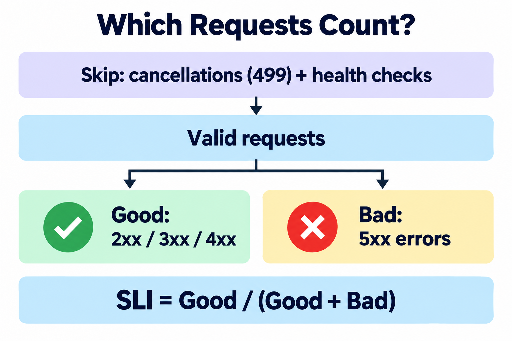
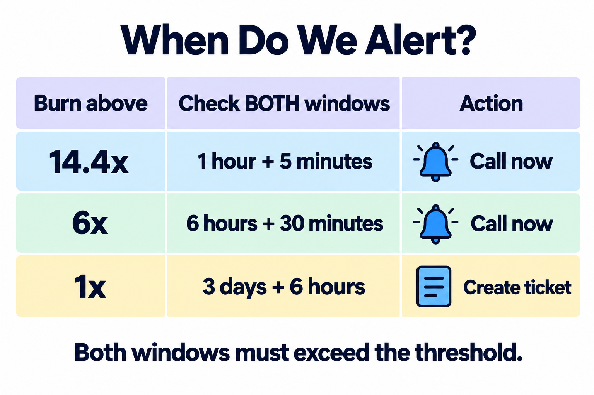
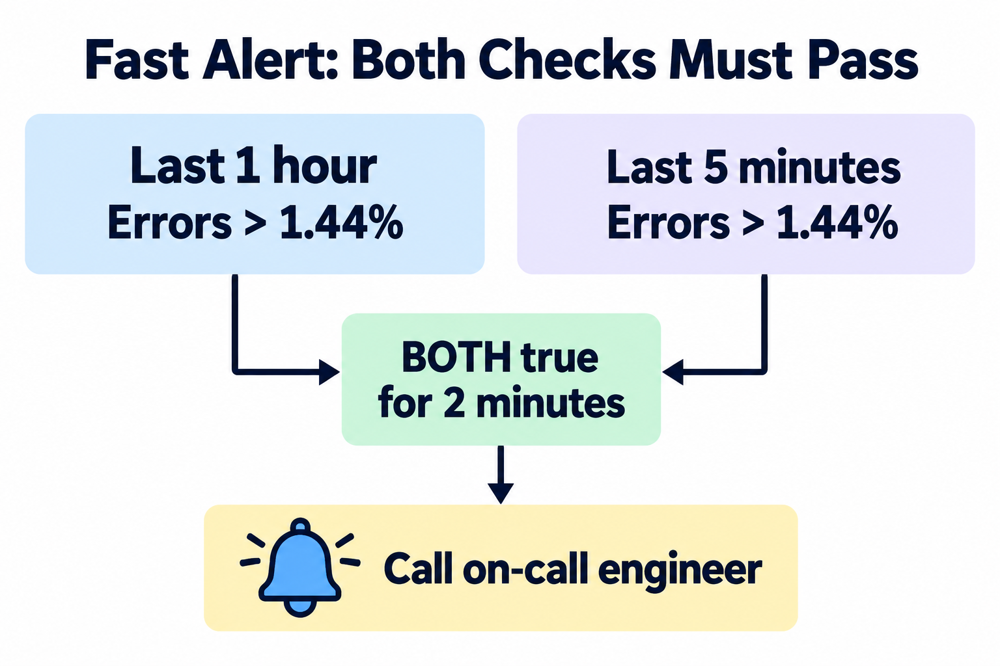

# SLOs and Error Budgets


An application programming interface (API) lets programs request data or actions. Define good service for an Orders API, calculate its failure allowance, and write a fast-burn alert.

## Objective


By the end of this lab, you can:
- Define a service level indicator (SLI), a measurement of service quality.
- Set a service level objective (SLO), a target for that measurement.
- Calculate an error budget and choose burn-rate alerts.

## Deliverable


Build `slo-document.md` and its supporting `orders-api-rules.yml` in a separate practice folder. All content is included below.

You need a Markdown editor and `promtool`, the Prometheus rule checker. No server is required. Linux setup is below; other platforms use [Prometheus downloads](https://prometheus.io/download/).

## SLI and SLO



An SLI measures results; an SLO sets the target. Our availability SLI counts requests without server errors. The gateway, the API's entry point, records each final HTTP status, a response code describing the outcome.

Here, 4xx responses count as good: the server handled an invalid request. Exclude cancelled requests, code 499, from both counts. This policy is specific to our API.

## Error Budget and Burn Rate


An error budget is the allowed bad fraction: `1 - SLO`. Multiply by valid requests to find the allowance. Monthly means rolling 30 days here.

Burn rate equals observed error ratio divided by allowed bad fraction. At steady traffic, a sustained 1x rate spends a fresh budget in 30 days; 14.4x spends it in 50 hours. A request-based SLI does not directly give downtime minutes.

## Step 1: Write the SLI


Create `slo-document.md` in your practice folder and add this contract.

```markdown
# Orders API SLO

## SLI
- Service: orders-api; owner: Orders API team.
- Source: production gateway request counts.
- Valid: completed requests, excluding code 499 and route /healthz.
- Good: valid requests with HTTP 2xx, 3xx, or 4xx.
- Bad: valid requests with HTTP 5xx, including gateway timeout 504.
- SLI = good requests / valid requests.
- Count each retry separately.
- Use checks from outside the system for requests that never reach the gateway.
```
**What this file does:** Defines the population and outcome used to measure availability.

---

## Step 2: Calculate the Error Budget


Append this worked example. Use actual valid request counts when evaluating a real month.

```markdown
## SLO
- Availability target: at least 99.9%, over a rolling 30 days.

## Monthly Error Budget
- Allowed bad fraction: 1 - 0.999 = 0.001 = 0.1%.
- Allowed bad requests: 10,000,000 x 0.001 = 10,000.

| Measure | Calculation or value |
| --- | --- |
| Valid requests | 10,000,000 |
| Allowed failures | 10,000 |
| Observed failures | 4,000 |
| Remaining budget | 10,000 - 4,000 = 6,000 |
| Consumed budget | 4,000 / 10,000 = 40% |

- Observed SLI: 1 - 4,000 / 10,000,000 = 99.96%; target met.
```
**What this file does:** Records a checkable target, budget, and measured outcome.

---

## Step 3: Set the Burn-Rate Thresholds



Copy this table under `## Alerts`. Both windows must exceed their threshold. The longer window detects sustained damage; the shorter confirms it continues.

| Speed | Long + short window | Burn threshold | Error ratio | Action |
| --- | --- | --- | --- | --- |
| Fast | 1h + 5m | >14.4x | >1.44% | Page now |
| Medium | 6h + 30m | >6x | >0.60% | Page now |
| Slow | 3d + 6h | >1x | >0.10% | Ticket |

These windows follow [Google's reliability guidance](https://sre.google/workbook/alerting-on-slos/). For example, `14.4 x 0.001 = 1.44%` errors spends 2% of the budget per hour at steady traffic. A page calls the on-call engineer; a ticket schedules work.

Add the response policy: investigate pages immediately; review tickets next working day. When the rolling budget is exhausted, pause nonessential releases and prioritize reliability fixes.

---

## Step 4: Write the Fast-Burn Rule



Create `orders-api-rules.yml` beside your document. The counter `http_requests_total` counts requests; labels `job`, `code`, and `route` identify the service, response code, and path. Each label combination is a time series, a sequence of measurements. Start good-response counts at zero.

```yaml
groups:
  - name: orders-api-slo
    rules:
      - alert: OrdersAPIErrorBudgetBurnFast
        expr: |
          (
            1 - sum(rate(http_requests_total{job="orders-api",code!~"5..|499",route!="/healthz"}[1h]))
            / sum(rate(http_requests_total{job="orders-api",code!="499",route!="/healthz"}[1h]))
            > 0.0144
          )
          and
          (
            1 - sum(rate(http_requests_total{job="orders-api",code!~"5..|499",route!="/healthz"}[5m]))
            / sum(rate(http_requests_total{job="orders-api",code!="499",route!="/healthz"}[5m]))
            > 0.0144
          )
        for: 2m
        labels:
          severity: page
        annotations:
          summary: "orders-api is burning its error budget fast"
```
**What this file does:** Calculates one minus the good-request fraction and checks both fast-burn windows.

`rate()` estimates requests per second, handling counts that restart at zero. `for: 2m` requires two minutes of matching results. Missing measurements or no traffic means unknown health, not 100% availability.

Reference this file as the fast-alert query sketch. Medium and slow rules are extension work using the table's settings. Adjust alerts for low traffic before production use.

---

## 5. Run the Following Commands in the Terminal


In your practice folder, install the checker on Linux x86-64 if needed. Keep each command on one line.

```bash
# paste this as one line
curl -fLO https://github.com/prometheus/prometheus/releases/download/v3.5.0/prometheus-3.5.0.linux-amd64.tar.gz
```
**Explanation:** Downloads the official Prometheus release into your practice folder.

```bash
tar -xzf prometheus-3.5.0.linux-amd64.tar.gz
```
**Explanation:** Extracts the downloaded tools.

```bash
./prometheus-3.5.0.linux-amd64/promtool check rules orders-api-rules.yml
```
**Explanation:** Validates your rule without starting a server.

If your terminal already recognizes `promtool`, use this instead:

```bash
promtool check rules orders-api-rules.yml
```
**Explanation:** Checks the same file using an existing installation.

**What to expect:** `SUCCESS: 1 rules found`. This checks file structure, not live measurements or delivered alerts. Production also needs data collection and alert delivery; see the [Prometheus rule documentation](https://prometheus.io/docs/prometheus/latest/configuration/recording_rules/).

Check your understanding: `0.02 / 0.001 = 20x` burn. A sustained 2% error ratio triggers the fast alert when both windows exceed 14.4x for two minutes.

## Verification Checklist


- [ ] `slo-document.md` identifies the owner, valid requests, and bad outcomes.
- [ ] The target uses rolling 30 days and budgets requests, not minutes.
- [ ] The worked budget leaves 6,000 requests, with 40% consumed.
- [ ] All three alert speeds have two windows and an action.
- [ ] The rule excludes 499 and health checks from both counts.
- [ ] `promtool check rules` succeeds.

## Conclusion


Your document connects API outcomes to budgets and alerts. Next, evaluate failover: switching traffic to healthy backups.
