# API SLOs and Error Budgets

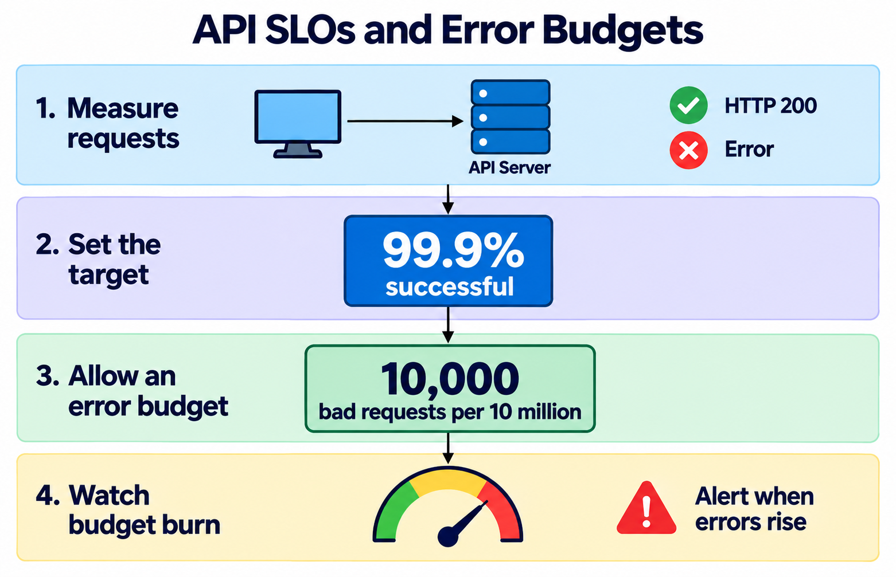

Define good API responses, set reliability targets, and calculate how many bad responses a sample API can afford.

## Objective

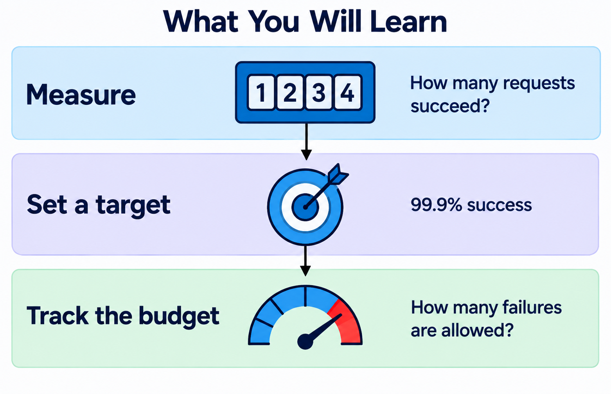

By the end of this lab, you can:
- Define service level indicators (SLIs), measurements of user experience.
- Set service level objectives (SLOs), targets for those measurements.
- Calculate a monthly error budget and its burn-rate thresholds.

## Deliverable

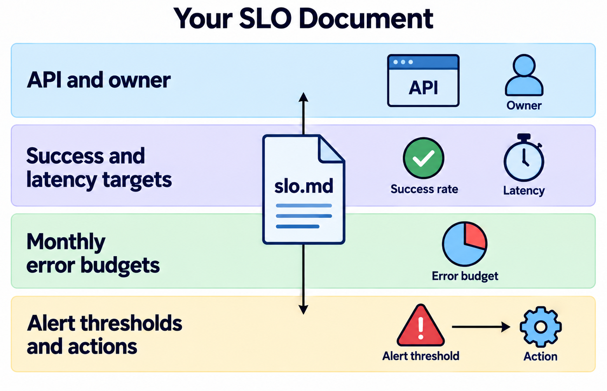

A Markdown file named `slo.md` with targets, query sketches, budgets, and alert thresholds. You need a text editor; Prometheus is optional.

## What Are SLIs and SLOs?

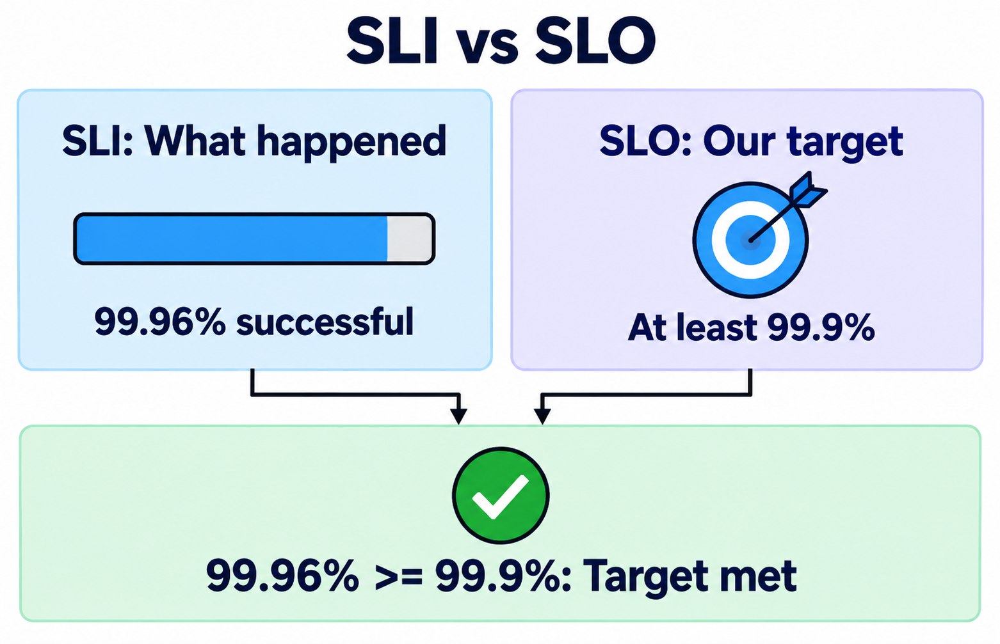

An SLI measures what happened. An SLO states how often that result should be good. A service level agreement (SLA) is a separate agreement that can include consequences for missing a promise.

| Term | Sample meaning |
| --- | --- |
| Success SLI | Fraction of requests returning HTTP 200 |
| Success SLO | At least 99.9% return HTTP 200 |
| Latency SLI | Fraction returning HTTP 200 within 300 ms |
| Latency SLO | At least 99% meet that condition |

## What Is an Error Budget?

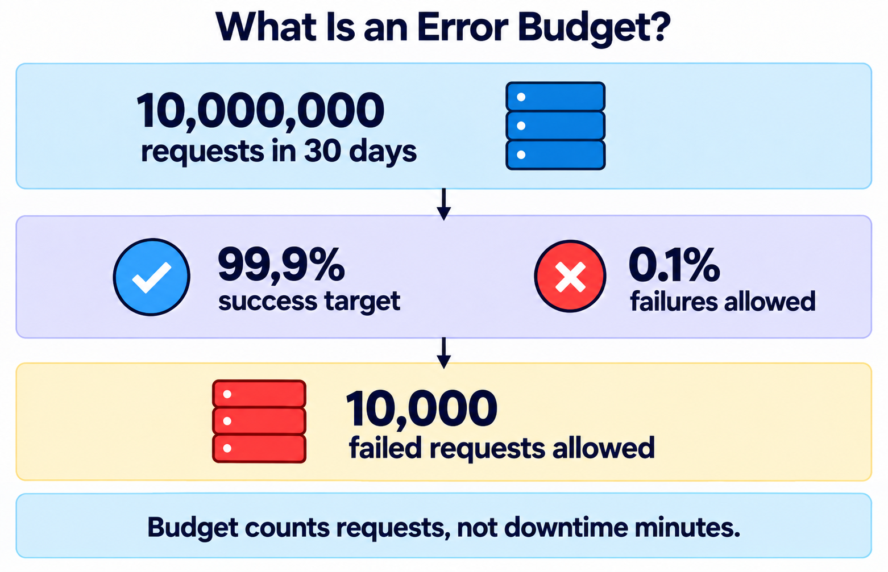

An error budget permits some bad service. Here, monthly means a rolling 30 days, or 720 hours. These budgets count requests, not minutes.

Budget equals total eligible requests multiplied by one minus the SLO. Keep the two budgets separate: a failed request counts against both, but a slow HTTP 200 counts only against latency.

## Step 1: Define the API Contract

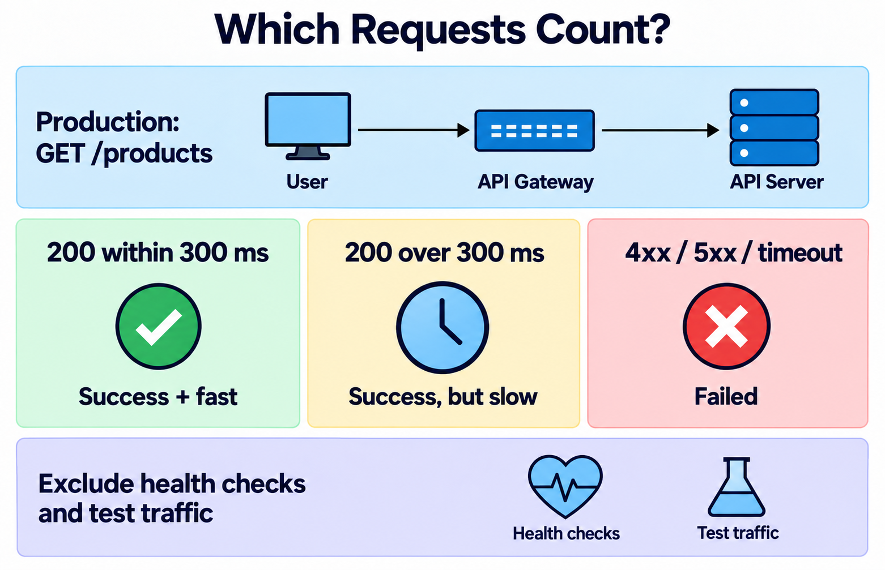

Create `slo.md` and add this contract. The gateway observes incoming requests and their final outcomes.

```markdown
# Sample API SLO

## Contract
- Service: catalogue-api
- Endpoint: GET /products
- Owner: API team
- Window: rolling 30 days
- Eligible traffic: production GET /products requests received by the gateway.
- Exclude health checks, metrics scrapes, and synthetic test traffic.
- Count each retry as another request.
- Success: HTTP 200. All other final statuses are bad, including 4xx and 5xx.
- Gateway timeouts count as HTTP 504 outcomes.
- Fast success: HTTP 200 with gateway duration at most 0.3 seconds.
- Success target: 99.9% of eligible requests.
- Fast-success target: 99% of eligible requests.
- Requests that never reach the gateway require separate external monitoring.
```
**What this file does:** Defines which requests count and what makes each response good.

---

## Step 2: Write the SLI Queries

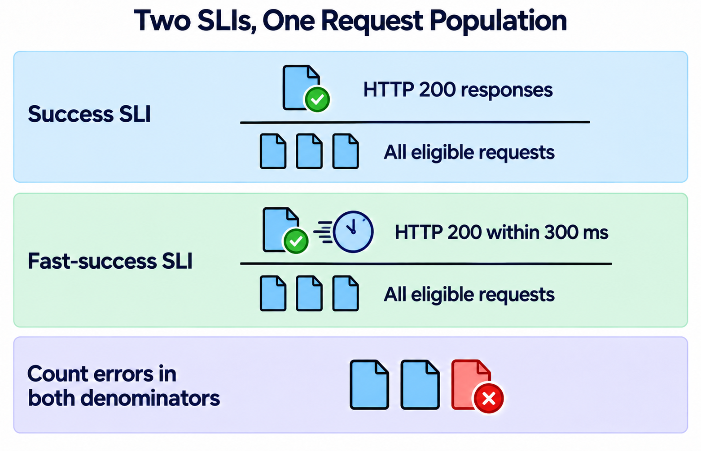

Add these sketches under `Measurement`. Assume gateway metrics with `job="catalogue-api"` contain only eligible traffic. Counter `api_requests_total` counts outcomes by `status`; classic histogram `api_request_duration_seconds` records every outcome with that status and a `0.3`-second bucket.

```promql
sum(increase(api_requests_total{job="catalogue-api",status="200"}[30d]))
/
sum(increase(api_requests_total{job="catalogue-api"}[30d]))
```
**Explanation:** Divides successful requests by all eligible requests across the rolling window.

```promql
sum(increase(api_request_duration_seconds_bucket{job="catalogue-api",status="200",le="0.3"}[30d]))
/
sum(increase(api_request_duration_seconds_count{job="catalogue-api"}[30d]))
```
**Explanation:** Divides fast successful responses by all eligible responses, including failures.

Results are fractions: `0.999` means 99.9%. Prometheus `increase()` accounts for counter resets and estimates the increase over the selected window. See the official [query functions](https://prometheus.io/docs/prometheus/latest/querying/functions/) and [histogram guidance](https://prometheus.io/docs/practices/histograms/).

Initialize expected status series, including HTTP 200, to zero. A zero denominator means no traffic, not perfect service. Missing samples mean unknown health: check telemetry separately, and retain at least 30 days of data.

---

## Step 3: Calculate the Monthly Budgets

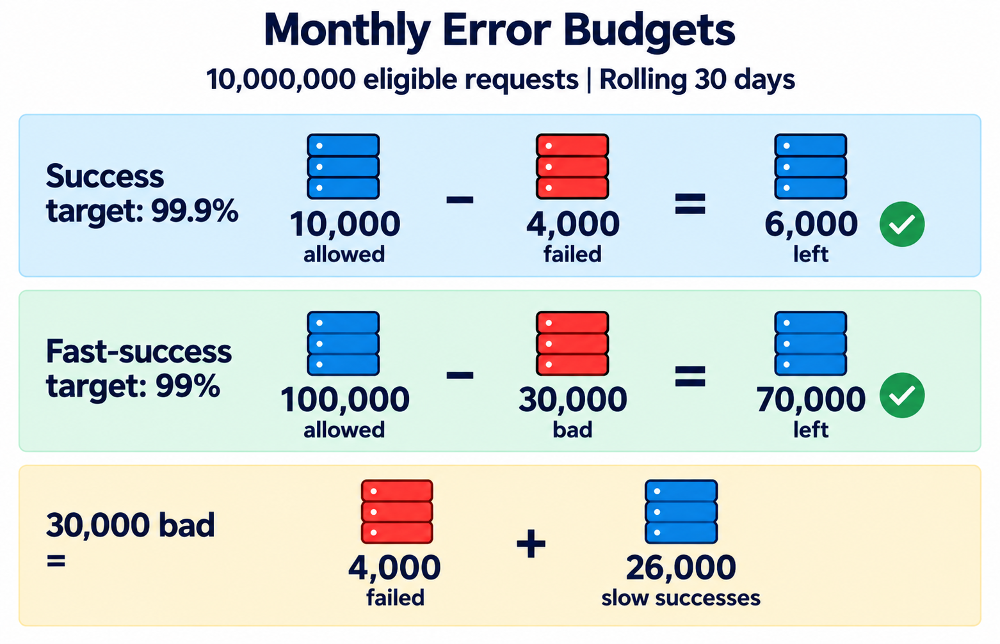

Add a `Budgets` section using this worked example: 10,000,000 eligible requests, 4,000 failed responses, and another 26,000 slow successful responses during 30 days.

| Indicator | Allowed bad fraction | Allowed bad | Observed bad | Remaining |
| --- | --- | --- | --- | --- |
| Success | 0.001 | 10,000 | 4,000 | 6,000 |
| Fast success | 0.01 | 100,000 | 30,000 | 70,000 |

Observed SLIs are 99.96% success and 99.7% fast success. Both pass. Recalculate allowances from actual traffic. A negative remaining budget means the objective was missed.

---

## Step 4: Set Burn-Rate Thresholds

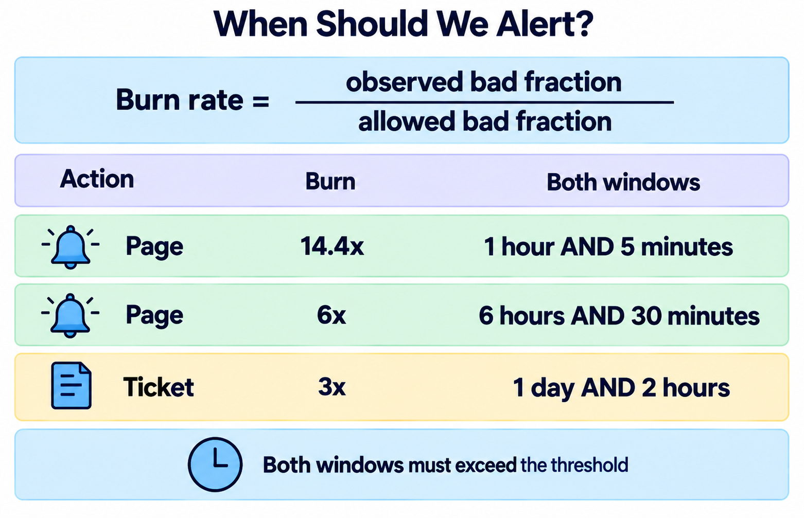

Burn rate is the observed bad fraction divided by the allowed bad fraction. At 1x, a sustained rate uses a full budget in 30 days. At 10x, it uses one in three days, assuming steady traffic and an initially unused budget.

Add these thresholds to an `Alerts` section. A page calls the on-call engineer; a ticket schedules investigation. Both windows in a row must exceed the threshold for the same SLI.

| Action | Burn rate | Long window | Short window | Budget share in long window |
| --- | --- | --- | --- | --- |
| Page | 14.4x | 1 hour | 5 minutes | 2% |
| Page | 6x | 6 hours | 30 minutes | 5% |
| Ticket | 3x | 1 day | 2 hours | 10% |

These pairs follow [Google's SRE alerting guidance](https://sre.google/workbook/alerting-on-slos/). Budget share equals burn rate times window hours divided by 720, assuming steady traffic. Use actual request counts to measure budget consumption when traffic varies.

---

## 5. Run the Following Queries in Prometheus


Calculate these values by hand in `slo.md`, or paste each expression into Prometheus. These expressions need no API metrics.

```promql
10000000 * (1 - 0.999)
```
**Explanation:** Calculates the success budget of approximately 10,000 requests.

```promql
4000 / 10000 * 100
```
**Explanation:** Shows that the sample failures consumed 40% of the success budget.

```promql
0.02 / (1 - 0.999)
```
**Explanation:** Shows that a current 2% failure fraction burns the success budget at approximately 20x.

**What to expect:** Approximately `10000`, `40`, and `20`, allowing for rounding. A 20x burn triggers a fast page only when both windows exceed the threshold.

For an instrumented API, add this fast-page query sketch to your document:

```promql
(
  (1 - sum(rate(api_requests_total{job="catalogue-api",status="200"}[1h]))
  / sum(rate(api_requests_total{job="catalogue-api"}[1h]))) / 0.001 > 14.4
)
and
(
  (1 - sum(rate(api_requests_total{job="catalogue-api",status="200"}[5m]))
  / sum(rate(api_requests_total{job="catalogue-api"}[5m]))) / 0.001 > 14.4
)
```
**Explanation:** Returns a result when both the one-hour and five-minute success burn rates exceed 14.4x.

For latency, use one minus the fast-success fraction and divide by `0.01`, with the same windows. Document the response policy: investigate pages immediately; when either monthly budget is exhausted, pause nonessential releases and prioritize reliability fixes. Low traffic requires separate alert tuning.

## Verification Checklist

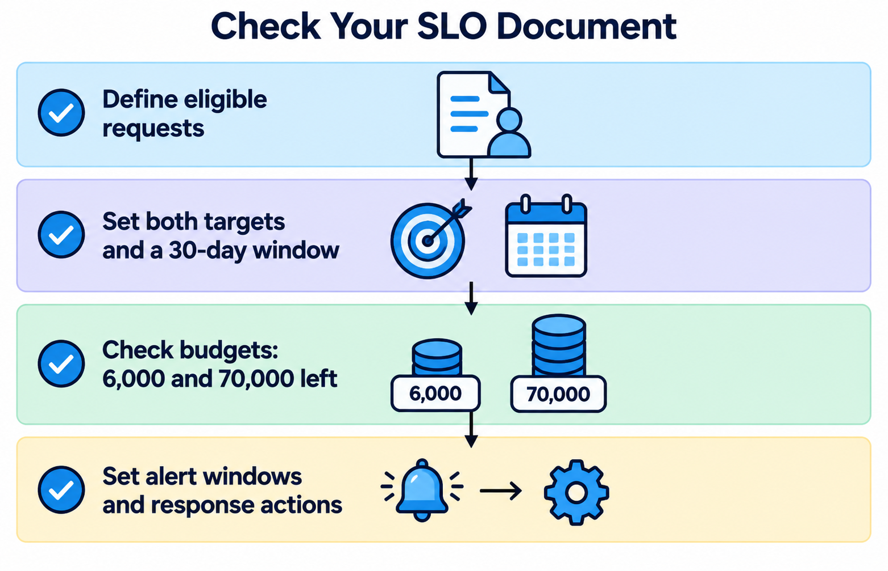

- [ ] Eligible traffic, timeouts, and measurement boundaries are explicit.
- [ ] Both SLIs have a target and a rolling 30-day window.
- [ ] Remaining budgets are 6,000 and 70,000 requests.
- [ ] A 2% failure fraction gives a 20x success burn rate.
- [ ] Alert thresholds include both windows and an action.
- [ ] `slo.md` includes queries and an exhausted-budget policy.

## Conclusion

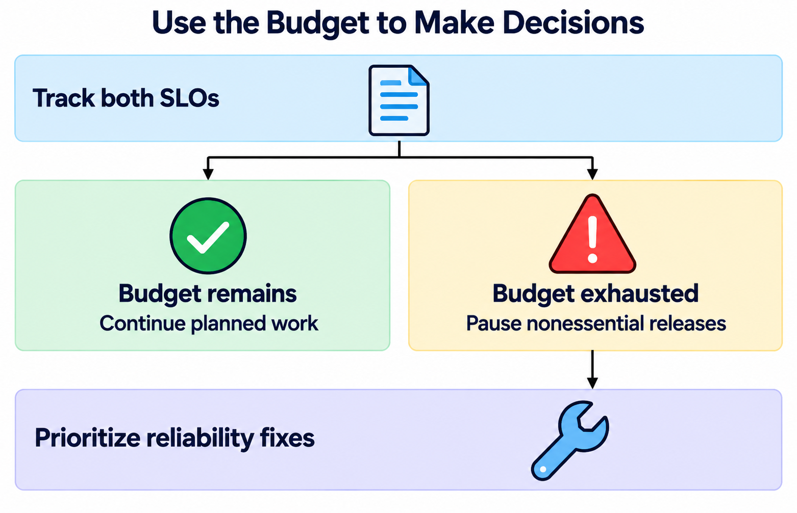

Your `slo.md` connects user outcomes to targets and actions. Next, judge whether failover restores service quickly enough.
