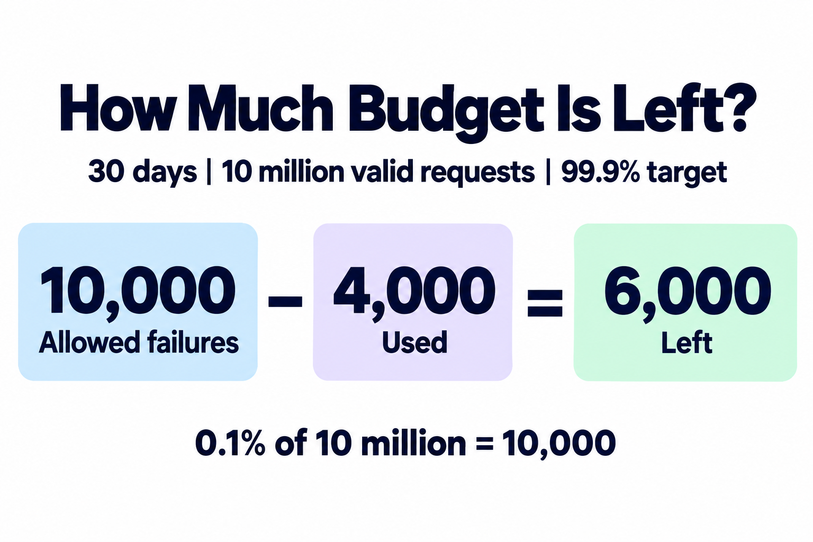
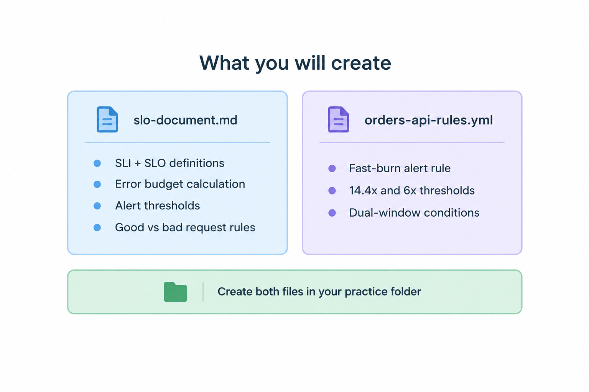
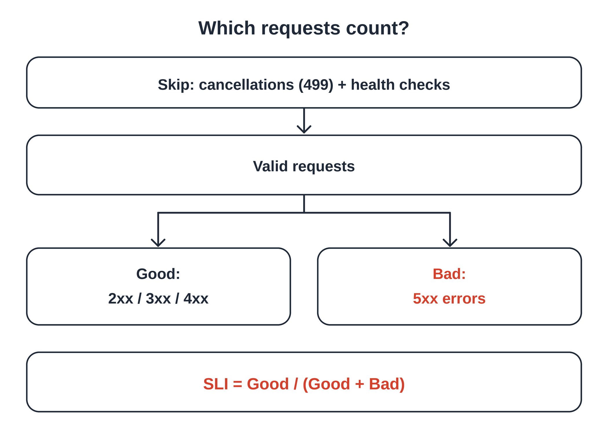
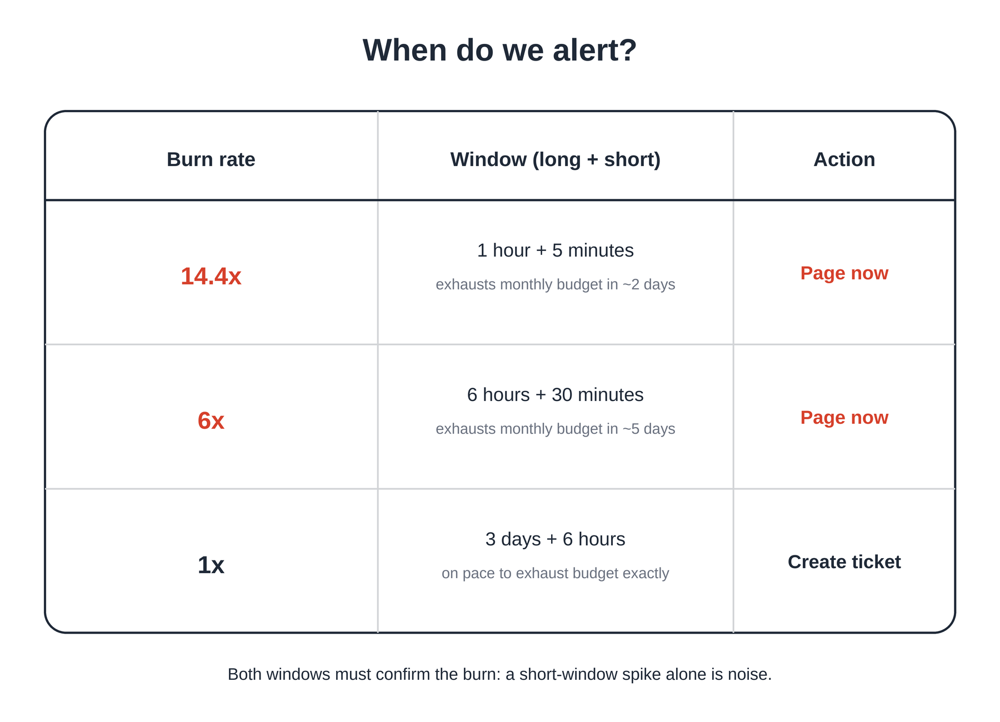
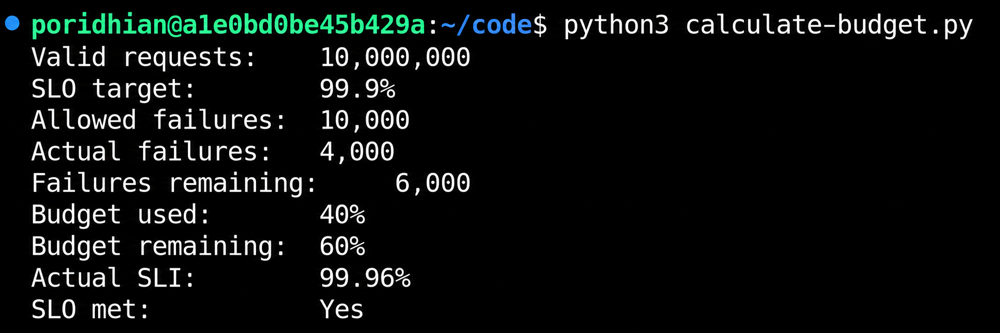
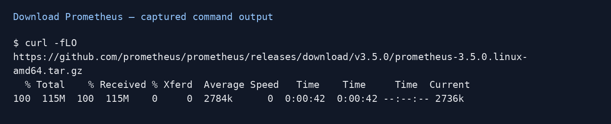
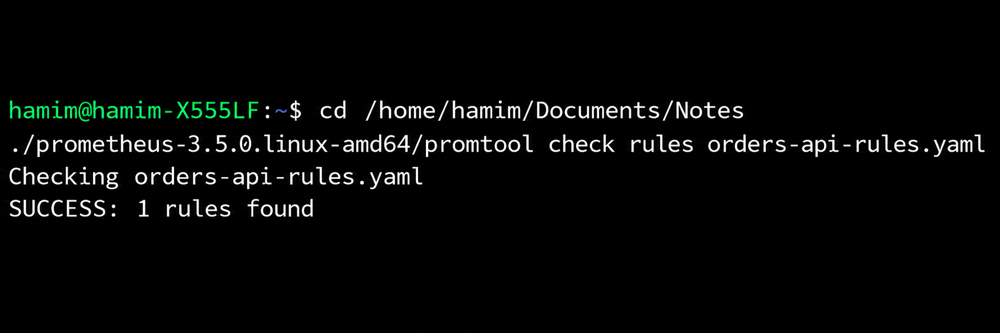

# SLO & Error Budget Definition

<p align="center">
  <a href="./images/budget.png">
    
  </a>
</p>

Set a target for the Orders API. An **API** lets programs request actions. Use Python 3 and a text editor.

## Objective

You will:

- Define good and bad requests.
- Set a 99.9% target over 30 days.
- Calculate the budget and write a fast-burn alert.

## Deliverable

<p align="center">
  <a href="./images/what-you-create.png">
    
  </a>
</p>

Create `slo-document.md`, `orders-api-rules.yaml`, and `calculate-budget.py`. **YAML** stores settings in text. Record three alert limits, called **thresholds**, but implement only the fast rule.

## Understand SLI and SLO

<p align="center">
  <a href="./images/which-requests-orginal.png">
    
  </a>
</p>

A **service level indicator (SLI)** measures reliability. A **service level objective (SLO)** sets the target: **99.9%** of counted requests without server errors over 30 days.

An **HTTP status code** describes a response. Exclude cancellations (`499`) and health checks (`/healthz`). Count other `2xx`, `3xx`, and `4xx` as good. Codes 500 through 599 (`5xx`) are bad. Good means no server error.

## Understand Error Budgets and Burn Rate

<p align="center">
  <a href="./images/burn-rate-alerting.png">
    
  </a>
</p>

The **error budget** is the number of failures the target allows. A 99.9% target allows **0.1%** failures: one per 1,000 counted requests. **Burn rate** compares the measured failure percentage with that allowance: `1.44% / 0.1% = 14.4x`.

A **window** is a past period. The long window checks lasting errors; the short one checks recent errors. Both must exceed the limit.

| Threshold | Long + short window | Failure percentage | Action |
| --- | --- | --- | --- |
| 14.4x (fast) | 1 hour + 5 minutes | Above 1.44% | Urgent message |
| 6x (medium) | 6 hours + 30 minutes | Above 0.60% | Urgent message |
| 1x (slow) | 3 days + 6 hours | Above 0.10% | Create task |

At steady traffic and errors, 14.4x uses a full 30-day allowance in `30 / 14.4`, about **2.08 days**. This budget counts requests.

## Step 1: Define the Request Rules

```text
All requests -> exclude 499 and /healthz -> good + bad
SLI = good / (good + bad) * 100
```

**Explanation:** Skipped requests do not enter either count.

Use these rules throughout:

| Response | Count as | Reason |
| --- | --- | --- |
| `200` or `302` | Good | No server error |
| `404` | Good | Client error |
| `499` | Skip | Client cancelled |
| `500` or `504` | Bad | Server error or gateway timeout |
| Any `/healthz` | Skip | Health check |

For 999 good and one bad request, the SLI is **99.9%**.

---

## Step 2: Write the Budget Calculator

```text
Counted requests * 0.001 = allowed failures
Allowed failures - actual failures = remaining budget
```

**Explanation:** A 99.9% target leaves 0.1%, or 0.001, for failures.

Create the practice folder:

```bash
mkdir -p m3-l2 && cd m3-l2
```

**Explanation:** Creates and opens the lab folder without printing output.

Use **10,000,000** counted requests and **4,000** errors. A **rolling window** uses the latest 30 days. Paste into `calculate-budget.py`:

```python
"""Calculate the request-based error budget used in this lab."""

valid_requests = 10_000_000
bad_requests = 4_000
slo = 0.999
allowed_failures = round(valid_requests * (1 - slo))
remaining = allowed_failures - bad_requests
sli = (valid_requests - bad_requests) / valid_requests * 100

print(f"Valid requests:    {valid_requests:,}")
print(f"SLO target:        {slo * 100:.1f}%")
print(f"Allowed failures:  {allowed_failures:,}")
print(f"Actual failures:   {bad_requests:,}")
print(f"Failures remaining:{remaining:>10,}")
print(f"Budget used:       {bad_requests / allowed_failures * 100:.0f}%")
print(f"Budget remaining:  {remaining / allowed_failures * 100:.0f}%")
print(f"Actual SLI:        {sli:.2f}%")
print(f"SLO met:           {'Yes' if sli >= slo * 100 else 'No'}")
```

**What this file does:** Calculates allowed failures, remaining budget, and the actual SLI.

---

## Step 3: Write the SLO Document

```text
Request rules -> target -> failure allowance -> alert limits
```

**Explanation:** The document records how the team measures and responds to failures.

Save this complete document as `slo-document.md`:

```markdown
# Orders API SLO

## SLI
- Owner: Orders API team.
- Source: production gateway request counts.
- Valid: completed requests excluding 499 and /healthz.
- Good: valid HTTP 2xx, 3xx, or 4xx responses.
- Bad: valid HTTP 5xx responses, including 504.
- SLI = good / valid. Count retries separately.

## SLO
At least 99.9% good requests over the last 30 days.

## Error Budget
Allowed failures = valid requests * 0.001.

| Measure | Value |
| --- | --- |
| Valid requests | 10,000,000 |
| Allowed failures | 10,000 |
| Actual failures | 4,000 |
| Remaining failures | 6,000 |
| Budget used | 40% |
| Actual SLI | 99.96% |

## Alerts

| Speed | Windows | Burn | Errors | Action |
| --- | --- | --- | --- | --- |
| Fast | 1h + 5m | >14.4x | >1.44% | Page |
| Medium | 6h + 30m | >6x | >0.60% | Page |
| Slow | 3d + 6h | >1x | >0.10% | Ticket |
```

**What this file does:** Records request rules, the target, budget, and alert limits.

A **retry** is another attempt. Count each separately. A **gateway** receives requests before the service.

---

## Step 4: Write the Alert Rule

<p align="center">
  <a href="./images/fast-alert.png">
    
  </a>
</p>

**Prometheus** collects measurements; **PromQL** calculates values from them. A **counter** increases as requests arrive. Save this as `orders-api-rules.yaml`:

```yaml
groups:
  - name: orders-api-slo
    rules:
      - alert: OrdersAPIErrorBudgetBurnFast
        for: 2m
        expr: |
          (
            1 - sum(rate(http_requests_total{job="orders-api",code!~"5..|499",route!="/healthz"}[1h]))
            / sum(rate(http_requests_total{job="orders-api",code!="499",route!="/healthz"}[1h]))
            > 0.0144
          )
          and
          (
            1 - sum(rate(http_requests_total{job="orders-api",code!~"5..|499",route!="/healthz"}[5m]))
            / sum(rate(http_requests_total{job="orders-api",code!="499",route!="/healthz"}[5m]))
            > 0.0144
          )
        labels:
          severity: page
        annotations:
          summary: "orders-api is burning its error budget fast"
```

**What this file does:** Alerts when both error percentages stay above 1.44% for two minutes.

Labels identify the service (`job`), status (`code`), and path (`route`). `rate()` calculates requests per second; `sum()` combines counts. The query calculates the error fraction; `0.0144` means 1.44%.

`and` requires both windows. `for: 2m` waits two minutes; either condition becoming false clears the wait. Notifications need running Prometheus with alert delivery configured.

---

## 5. Run the following commands in the terminal

From `m3-l2`, run the saved calculator:

```bash
python3 calculate-budget.py
```

**Explanation:** Prints the budget and measured good-request percentage.

<p align="center">
  <a href="./images/budget-output.png">
    
  </a>
</p>

**What to expect:** **10,000** failures are allowed; **6,000** remain and **40%** is used. The **99.96%** SLI exceeds the target, so `SLO met` is `Yes`.

### Download the Rule Tool

Use `promtool`, the Prometheus rule-file tool. These commands need `curl` and `tar` on Linux with a 64-bit Intel or AMD processor:

```bash
# paste this as one line
curl -fLO https://github.com/prometheus/prometheus/releases/download/v3.5.0/prometheus-3.5.0.linux-amd64.tar.gz
```

**Explanation:** Downloads the archive containing the tool.

<p align="center">
  <a href="./images/download-output.png">
    
  </a>
</p>

**What to expect:** The screenshot shows **11%**. Wait for `100` and the prompt before extracting.

### Extract the Tool

```bash
# paste the tar command as one line
tar -xzf prometheus-3.5.0.linux-amd64.tar.gz prometheus-3.5.0.linux-amd64/promtool
ls prometheus-3.5.0.linux-amd64
```

**Explanation:** Extracts only the tool and lists its folder.

<p align="center">
  <a href="./images/extract-output.png">
    
  </a>
</p>

**What to expect:** `tar` prints nothing; `ls` prints `promtool`. Paste the command as one line.

### Run the Rule Tool

```bash
./prometheus-3.5.0.linux-amd64/promtool check rules orders-api-rules.yaml
```

**Explanation:** Reads the rule file and reports whether it is written correctly.

<p align="center">
  <a href="./images/run-output.png">
    
  </a>
</p>

**What to expect:** `SUCCESS: 1 rules found` means the rule was accepted. Stay in `m3-l2`; this does not send alerts.

---

## Conclusion

You defined a target, calculated its budget, and wrote an alert. Next, spread requests across servers and handle server failures.
