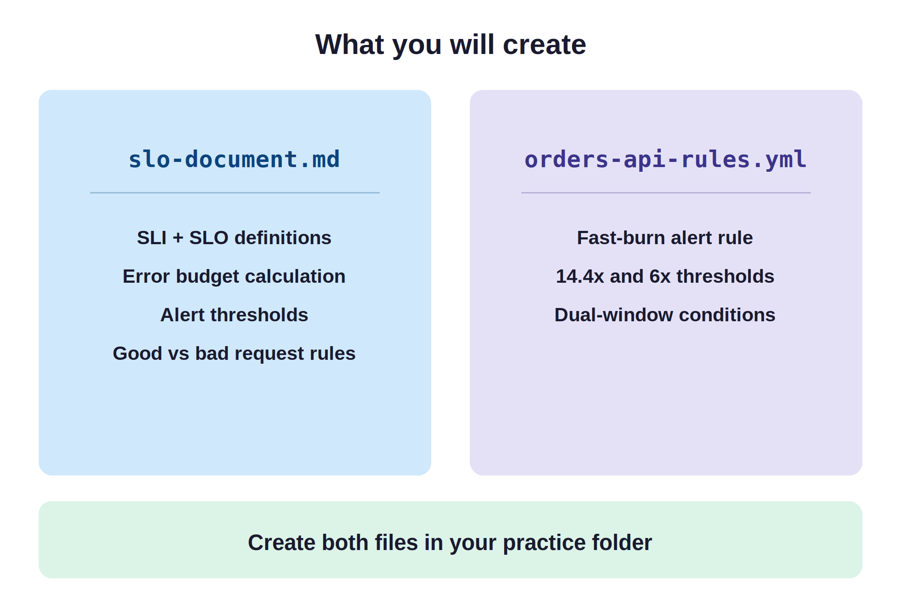
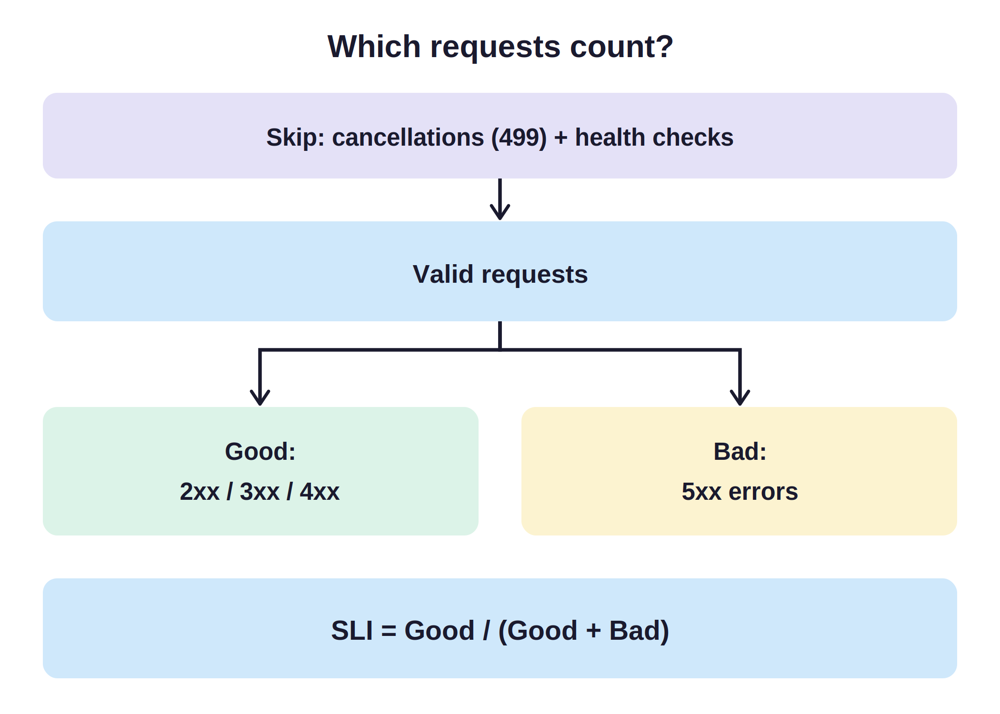
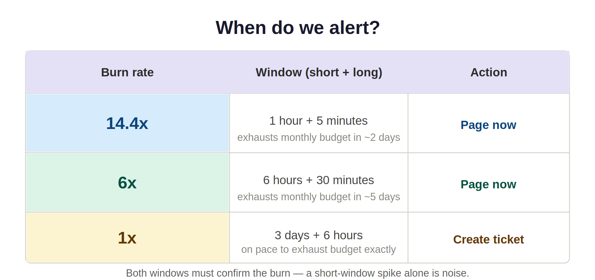
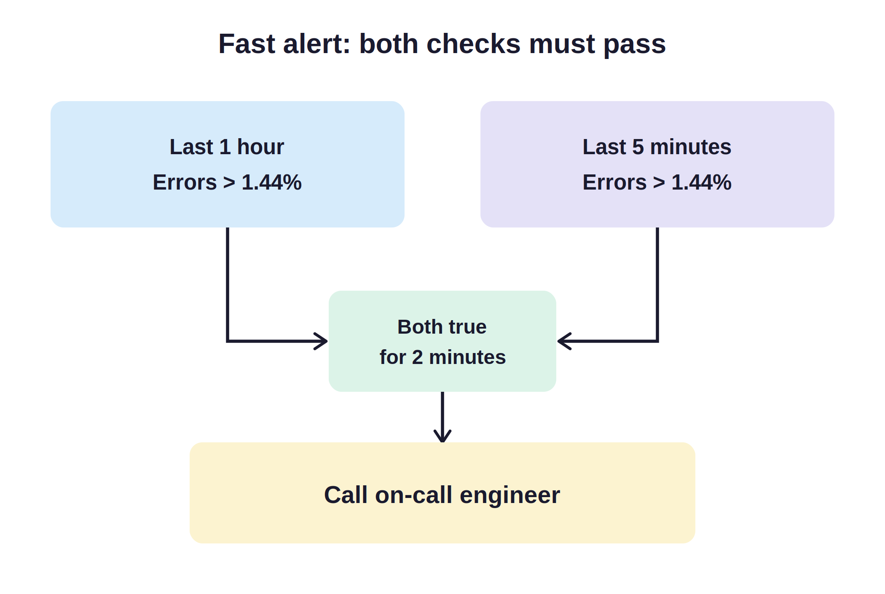

# SLOs and Error Budgets


An API lets programs request data or actions. In this lab, you define good service for an Orders API, calculate its failure budget, and write a fast-burn alert rule.

## Objective

By the end of this lab, you can:
- Define SLIs and SLOs for a sample API (Orders API).
- Derive its monthly error budget and failure allowance.
- Configure multi-window budget burn-rate alert thresholds.
- Validate Prometheus query sketches using `promtool`.

## Deliverable



An SLO document with budget burn-rate thresholds named `slo-document.md`, and a supporting Prometheus query sketch file named `orders-api-rules.yml`.

- **Tools and Stack:** Markdown, Prometheus query sketches (`promtool`).

## Which Requests Count? (SLI and SLO)



An SLI measures service performance; an SLO sets the target percentage. For the Orders API, the gateway records each request and final HTTP code. Client cancellations (code 499) and health checks (`/healthz`) are filtered out first. From the remaining valid requests, responses with 2xx, 3xx, and 4xx count as good, while 5xx server errors count as bad.

## When Do We Alert? (Error Budgets and Burn Rate)



An error budget is the allowed bad fraction: `1 - SLO`. A 99.9% target over rolling 30 days permits 0.1% failures. Burn rate measures how fast your service spends this budget. A 1x burn rate drains the budget in 30 days; 14.4x exhausts it in two days. Both a short and long window must confirm the burn to prevent false pages from brief spikes.

## Step 1: Write the SLI Specification

Create `slo-document.md` in your practice folder to document the service boundary and request filtering rules.

```text
All Gateway Requests
       │
       ├── Code 499 (Client Cancel) ──> [ EXCLUDE ]
       ├── Route /healthz           ──> [ EXCLUDE ]
       │
       ▼
  Valid Requests
       ├── 2xx, 3xx, 4xx            ──> [ GOOD ]
       └── 5xx (Server Error)       ──> [ BAD ]
```

```markdown
# Orders API SLO

## SLI
- Service: orders-api; owner: Orders API team.
- Source: production gateway request counts.
- Valid: completed requests, excluding code 499 and route /healthz.
- Good: valid requests with HTTP 2xx, 3xx, or 4xx.
- Bad: valid requests with HTTP 5xx, including gateway timeout 504.
- SLI = good requests / valid requests.
- Count each retry separately.
- Use checks from outside the system for requests that never reach the gateway.
```

**What this file does:** Defines the request filters and classification rules used to measure API availability.

---

## Step 2: Calculate the Error Budget

Append the error budget calculation to `slo-document.md` to establish your monthly failure allowance.

```text
10,000,000 Valid Requests  x  0.1% Allowed Bad
             │
             ▼
    10,000 Allowed Failures (Monthly Error Budget)
             │
             ├── 4,000 Observed Failures (40% Consumed)
             └── 6,000 Remaining Failures (60% Remaining)
```

```markdown
## SLO
- Availability target: at least 99.9%, over a rolling 30 days.

## Monthly Error Budget
- Allowed bad fraction: 1 - 0.999 = 0.001 = 0.1%.
- Allowed bad requests: 10,000,000 x 0.001 = 10,000.

| Measure | Calculation or value |
| :--- | :--- |
| Valid requests | 10,000,000 |
| Allowed failures | 10,000 |
| Observed failures | 4,000 |
| Remaining budget | 10,000 - 4,000 = 6,000 |
| Consumed budget | 4,000 / 10,000 = 40% |

- Observed SLI: 1 - 4,000 / 10,000,000 = 99.96%; target met.
```

**What this file does:** Records the 30-day availability target, allowed failure budget, and observed consumption.

---

## Step 3: Set the Burn-Rate Thresholds

Add the alerting policy to `slo-document.md` to define when engineers must be paged.

```text
                  1-Hour Window (>14.4x Burn)
                              │
                              ▼
                     [ Sustained Damage? ]
                              │
                              ├── YES ──> Check 5-Minute Window (>14.4x Burn)
                              │                     │
                              │                     ▼
                              │            [ Still Burning Now? ]
                              │                     │
                              │                     ├── YES ──> [ PAGE NOW ]
                              │                     └── NO  ──> (Transient spike, suppress)
                              │
                              └── NO  ──> (Normal traffic, suppress)
```

```markdown
## Alerts

| Speed | Long + short window | Burn threshold | Error ratio | Action |
| :--- | :--- | :--- | :--- | :--- |
| Fast | 1h + 5m | >14.4x | >1.44% | Page now |
| Medium | 6h + 30m | >6x | >0.60% | Page now |
| Slow | 3d + 6h | >1x | >0.10% | Create ticket |
```

**What this file does:** Sets the dual-window thresholds and team actions for fast, medium, and slow budget burn.

These windows follow Google SRE reliability practices. A 14.4x burn rate consumes 2% of the budget in one hour. Investigate pages immediately, and review slow-burn tickets on the next business day. When the budget is exhausted, halt new features and focus on reliability fixes.

---

## Step 4: Write the Fast-Burn Alert Rule

Create `orders-api-rules.yml` in your practice folder to implement the fast-burn alert rule.



```yaml
groups:
  - name: orders-api-slo
    rules:
      - alert: OrdersAPIErrorBudgetBurnFast
        expr: |
          (
            1 - sum(rate(http_requests_total{job="orders-api",code!~"5..|499",route!="/healthz"}[1h]))
            / sum(rate(http_requests_total{job="orders-api",code!="499",route!="/healthz"}[1h]))
            > 0.0144
          )
          and
          (
            1 - sum(rate(http_requests_total{job="orders-api",code!~"5..|499",route!="/healthz"}[5m]))
            / sum(rate(http_requests_total{job="orders-api",code!="499",route!="/healthz"}[5m]))
            > 0.0144
          )
        for: 2m
        labels:
          severity: page
        annotations:
          summary: "orders-api is burning its error budget fast"
```

**What this file does:** Checks both the 1-hour and 5-minute error rates simultaneously and triggers an immediate page if both exceed 1.44% for two minutes.

`rate()` handles counter resets, and `for: 2m` requires the condition to hold for two minutes.

---

## 5. Run the following commands in the terminal

Download Prometheus to extract `promtool` and validate your alert rules.

```bash
# paste this as one line
curl -fLO https://github.com/prometheus/prometheus/releases/download/v3.5.0/prometheus-3.5.0.linux-amd64.tar.gz
```

**Explanation:** Downloads the official Prometheus archive containing `promtool`.

```bash
tar -xzf prometheus-3.5.0.linux-amd64.tar.gz
```

**Explanation:** Extracts the Prometheus binaries to your practice folder.

```bash
./prometheus-3.5.0.linux-amd64/promtool check rules orders-api-rules.yml
```

**Explanation:** Validates your rule syntax and PromQL queries without starting a server. If `promtool` is already installed on your system, you can run `promtool check rules orders-api-rules.yml` directly.


**What to expect:** The output prints `SUCCESS: 1 rules found` as shown in the screenshot. This confirms your YAML formatting and PromQL syntax are completely valid.

## Verification checklist

- [ ] `slo-document.md` defines service ownership, valid requests, and error classifications.
- [ ] The availability objective targets 99.9% over a rolling 30-day window.
- [ ] The error budget calculation leaves 6,000 allowed failures after 40% consumption.
- [ ] The alert policy defines dual windows for fast, medium, and slow burn rates.
- [ ] `orders-api-rules.yml` excludes client cancels (499) and health checks (`/healthz`).
- [ ] `promtool check rules orders-api-rules.yml` returns `SUCCESS: 1 rules found`.

## Conclusion

You created a production-ready reliability contract for an Orders API. You connected a raw request SLI to an error budget and configured multi-window alerts to detect real service degradations. Next, examine how load balancing and automated failover switch traffic to healthy backup nodes.
