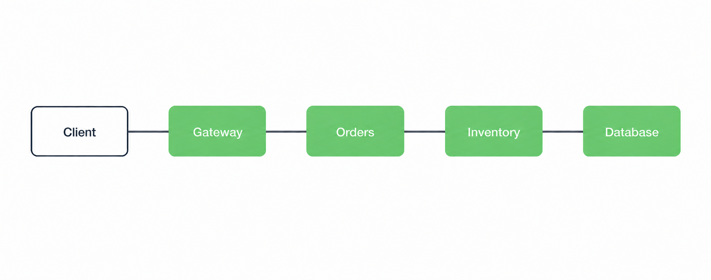
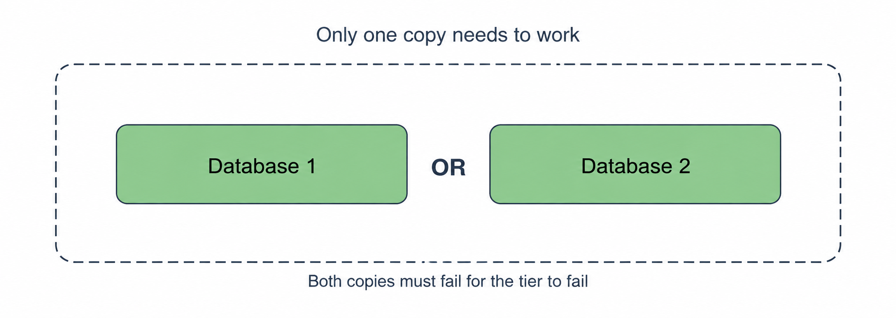
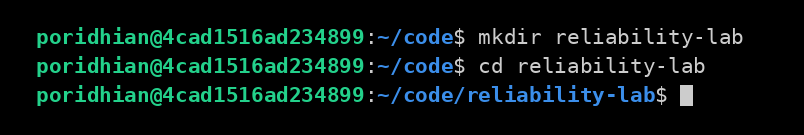
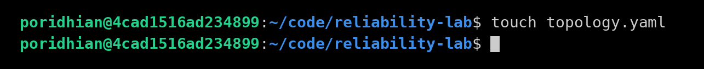
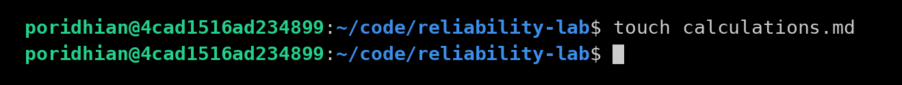
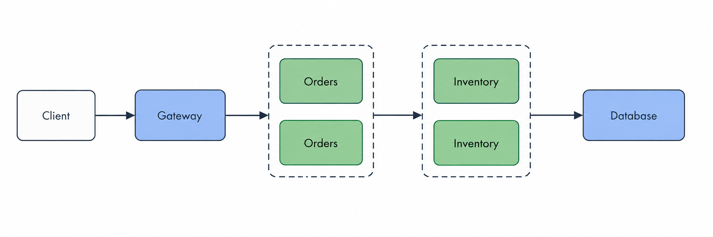
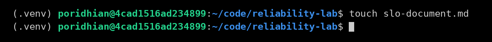
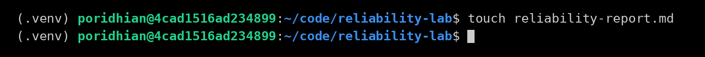

# Topology Driven Reliability Modeling

Build a model of a small service and calculate how often it should be available. Check your answers with Node.js. Then write a reliability target and a short report explaining your design.

## Objective

By the end of this lab, you can:

- Describe the parts of a service in `topology.yaml`.
- Calculate the availability of the whole service by hand, then check it with Node.js.
- Choose a reliability target and explain why your design can meet it.

## Deliverable

Create six files: `topology.yaml`, `topology-improved.yaml`, `calculations.md`, `analyze_topology.js`, `slo-document.md`, and `reliability-report.md`. Keep the report to one page. Choose a target for either the starting design, called the baseline, or the improved design.

## How the parts work together



A topology describes how the parts of a system connect. Each stage is called a tier. Availability means the share of time a service can handle requests.

In a serial chain, every tier must work for a request to succeed. Orders and Inventory do different jobs, so the request needs both.

Multiply the availability of the required parts to find the availability of the whole system. This is called composite availability. The whole chain cannot be more available than its least available part.

Will this chain be more or less available than its least available part? Write down your guess and check it in Step 2.

## How extra copies help



Parallel copies do the same job. The diagram shows two database copies as an example. In Step 5, you add copies of Orders and Inventory and keep one database.

An extra copy is called a replica. If either of two copies can handle the request, use this formula:

```text
A_tier = 1 - (1 - A_copy1) x (1 - A_copy2)
```

**Explanation:** The tier fails only when both copies fail.

A tier with one copy has that copy's availability. Step 1 starts with one copy per tier; Step 5 adds more.

## SLO and error budget


The picture makes the error budgets look larger so they are easy to see. Use the numbers for your calculations.

A service level objective (SLO) is a target for how often requests should succeed. A 99.9% SLO allows 0.1% of requests to fail. These allowed failures are the error budget. A higher target allows fewer failures.

## What we assume in this model

A model is a simple version of a real system. Our calculations use these assumptions:

- The client sends requests but is not part of the calculation. We include only Gateway, Orders, Inventory, and Database.
- All four tiers must work for a request to succeed.
- Failures are independent: one part failing does not make another more likely to fail.
- The model leaves out repeated attempts, backup request paths, and the time needed to switch to a working copy.
- If a copy fails, requests reach a working copy. That copy can handle all the traffic alone.
- Copies can fail together if they share a power supply, network, or location. The calculation does not include these shared failures.

The availability values in this lab are practice numbers, not measurements from a real service.

---

## Before you start: Create a lab folder

You need a terminal, Node.js with npm, and a text editor. The terminal commands in this lab use Bash on Linux or macOS.

Run these commands once:

```bash
mkdir -p reliability-lab
cd reliability-lab
```

Open this folder in your text editor. Create and save all six deliverable files here. Run every remaining terminal command from this folder.

<p align="center">
  <a href="images/reliability-lab.png">
    
  </a>
</p>

**Folder setup:** The terminal is now inside `reliability-lab`, where the remaining commands should run.

You are modeling a service, not deploying one. You do not need to start a Gateway, Orders service, Inventory service, or Database.

## Step 1: Describe the starting design in topology.yaml
Create the file from your lab folder:

```bash
touch topology.yaml
```

<p align="center">
  <a href="images/topology-yaml.png">
    
  </a>
</p>

**File creation:** `touch` creates `topology.yaml` if it does not exist. Add the content described below in your editor; this screenshot shows file creation only.

**Your task:** Create a file named `topology.yaml` in your lab folder. Copy the YAML block below into it and save it.

A **tier** is one required part of the service. A **copy** is an instance that can do that tier's job. The starting design has four tiers, with one copy in each tier.

For this exercise, a successful request needs every tier in this path:

```text
Client  --->  Gateway  --->  Orders  --->  Inventory  --->  Database
              (99.95%)       (99.9%)       (99.9%)          (99.99%)
```

```yaml
service: ordering-api
window_days: 30
monthly_valid_requests: 1000000
slo_targets_percent: [99.5, 99.9]

# Tiers are required in series. A request must pass through every tier.
# Copies inside a tier are interchangeable parallel replicas.
tiers:
  - name: gateway
    copies:
      - availability_percent: 99.95

  - name: orders
    copies:
      - availability_percent: 99.9

  - name: inventory
    copies:
      - availability_percent: 99.9

  - name: database
    copies:
      - availability_percent: 99.99
```

Read the file using this guide:

| Field | Meaning in this lab |
|---|---|
| `service` | A name for the service: `ordering-api`. |
| `window_days` | The period we model: 30 days. |
| `monthly_valid_requests` | The number of requests counted during that period: 1,000,000. |
| `slo_targets_percent` | The two success targets we will compare: 99.5% and 99.9%. |
| `tiers` | The four parts that must all work. |
| `copies` | The instances that can do one tier's job. |
| `availability_percent` | How often a copy is assumed to be available. Enter `99.95`, not `0.9995`. |

**Check before continuing:** Your file should contain four `name` entries and one `availability_percent` entry under each. Keep the indentation exactly as shown. Use spaces, not tabs; YAML uses indentation to group values. Each `-` starts a list item.

For this exercise, assume the Database is a managed multi-AZ service with 99.99% availability. This is a practice assumption, not a provider guarantee. Its internal redundancy is already included in that value, so represent it as one logical copy in the model.

---

## Step 2: Calculate availability by hand
Create the file from your lab folder:

```bash
touch calculations.md
```

<p align="center">
  <a href="images/calculations.png">
    
  </a>
</p>

**File creation:** `touch` creates `calculations.md` if it does not exist. Add the content described below in your editor; this screenshot shows file creation only.

**Your task:** Create `calculations.md` in the same folder. This file contains your written calculations, not JavaScript code. Open it in your text editor and write the formulas and answers as Markdown. You do not run this file with Node.js.

Build it in three parts: **Baseline design** in this step, **SLO comparison** in Step 3, and **Improved design** in Step 5. A complete copyable example appears at the end of Step 5 under “What to write in calculations.md.” The filename is `calculations.md` (plural).

Complete these calculations in order:

1. Convert each component's percentage to a decimal.
2. Multiply the four decimals to get system availability.
3. Multiply that result by 100 to express it as a percentage.
4. Calculate the unavailable fraction: `1 - A_system`.
5. Multiply the unavailable fraction by 43,200 to estimate downtime in minutes.
6. Use the nines formula below to describe the result.

For example, the Gateway's availability becomes:

```text
99.95 / 100 = 0.9995
```

Use the formulas below. Here, `A` means availability as a decimal. A 30-day month has 43,200 minutes.

Nines describe how close availability is to 100%: 99% is two nines, and 99.9% is three. A result of 2.585 nines falls between them. Use a calculator with `log10` to find this value.

```text
A_system = A_gateway x A_orders x A_inventory x A_database
nines ≈ -log10(1 - A_system)
downtime_minutes ≈ (1 - A_system) x 43200
```

Try the calculation first, then compare your answer below.

```text
A_system = 0.9995 x 0.999 x 0.999 x 0.9999 ≈ 0.99740225
A_system percent ≈ 99.740225%
nines ≈ 2.585
downtime ≈ 112.22 minutes over 30 days
```

**Explanation:** The whole chain has lower availability than any of its parts, which answers your earlier guess.

---

## Step 3: Compare two SLO targets and their error budgets

**Your task:** Add an “SLO comparison” section to `calculations.md`.

An **SLO** is the success target you choose. An **error budget** is the number of failures that target allows. For example, a 99.5% success target allows 0.5% of counted requests to fail.

Use 1,000,000 counted requests over 30 days. For each target, calculate the allowed failure fraction and multiply it by 1,000,000:

```text
For 99.5%:
allowed_failure_fraction = 1 - 0.995 = 0.005
allowed_failed_requests = 1,000,000 x 0.005 = 5,000
```

Repeat this for 99.9%, then compare your answers with the table below. Record which target the baseline can meet in the model.

```text
allowed_failure_fraction = 1 - (SLO_percent / 100)
allowed_failed_requests = valid_requests x allowed_failure_fraction
```

| SLO target | Allowed failure fraction | Allowed failed requests | Equivalent time allowance | Baseline meets target |
|---|---|---|---|---|
| 99.5% | 0.5% | 5,000 | 216 minutes | Yes |
| 99.9% | 0.1% | 1,000 | 43.2 minutes | No |

The time allowance is the downtime that matches the target over 30 days. To estimate failed requests from downtime, assume requests arrive at the same rate all month and fail while the service is down:

```text
predicted_failed_requests = (downtime_minutes / 43200) x valid_requests
predicted_failed_requests ≈ (112.22 / 43200) x 1,000,000 ≈ 2,598
```

**Explanation:** About 2,598 failures fit within the 99.5% budget but exceed the 99.9% budget.

**Traffic caveat:** The 2,598 estimate assumes a uniform request rate. The same downtime during peak traffic can cause more failures; during quiet periods it can cause fewer. Equivalent downtime alone does not establish a request-based SLO result. Use real request counts to check whether a live service meets its target. If the number of requests changes, calculate the budget again.

---

## Step 4: Write the Node.js calculator

**Your task:** Set up a Node.js project, then create `analyze_topology.js` in your lab folder.

### Install Node.js and npm

On Ubuntu or Debian, run these commands one at a time. If Node.js and npm are already installed, skip to the version checks below.

```bash
sudo apt update
```

**Explanation:** Updates the list of available packages.

```bash
sudo apt install -y nodejs npm
```

**Explanation:** Installs Node.js and npm.

On macOS, download and run the LTS installer from the [Node.js website](https://nodejs.org/en/download). It installs both Node.js and npm. Then reopen your terminal.

Check that both commands print a version:

```bash
node --version
npm --version
```

Run the following commands one at a time from `reliability-lab`.

```bash
npm init -y
```

**Explanation:** Creates `package.json` to track the lab's Node.js project and packages.

```bash
npm install yaml@2
```

**Explanation:** Installs the [yaml package](https://eemeli.org/yaml/) that reads YAML files. npm creates `node_modules/` and `package-lock.json`. Dependencies stay in this lab folder; no environment activation is needed.

**Check the installation:** Confirm that Node.js can read YAML:

```bash
node -e "require('yaml'); console.log('YAML is ready')"
```

Expected output:

```text
YAML is ready
```

If installation fails, read the error message first. If npm cannot reach the package registry, check your network access and retry `npm install yaml@2`. If `node` or `npm` is not found, install Node.js with npm before continuing. Continue only after the import check succeeds.

Now create `analyze_topology.js`, copy the complete code below into it, and save it. You can use the supplied code without writing it from scratch. Your job is to understand its calculation and compare its results with your hand calculations.

```bash
touch analyze_topology.js
```

**Calculator file:** After creating the file, paste and save the complete JavaScript code below before running it. This code uses CommonJS, the default module format in the project created by `npm init -y`.

The calculator follows this order:

1. Read the YAML file.
2. Calculate availability for the copies in each tier.
3. Multiply the tier availabilities because every tier is required.
4. Calculate downtime and predicted failed requests.
5. Compare predicted failures with each target's error budget.

```text
topology.yaml -> load -> parallel availability per tier -> multiply tiers -> nines, downtime, SLO check
```

```javascript
const fs = require('node:fs');
const YAML = require('yaml');

function required(mapping, key, location) {
  if (mapping === null || typeof mapping !== 'object' || Array.isArray(mapping)) {
    throw new Error(`${location} must be a YAML mapping`);
  }
  if (!Object.prototype.hasOwnProperty.call(mapping, key)) {
    throw new Error(`${location}: missing required key '${key}'`);
  }
  return mapping[key];
}

function number(value, location, upper = Infinity) {
  if (typeof value !== 'number' || !Number.isFinite(value) || value <= 0 || value > upper) {
    const bounds = Number.isFinite(upper) ? `above 0 and at most ${upper}` : 'above 0';
    throw new Error(`${location} must be a finite number ${bounds}, got ${String(value)}`);
  }
  return value;
}

function nonemptyList(value, location) {
  if (!Array.isArray(value) || value.length === 0) {
    throw new Error(`${location} must be a non-empty list`);
  }
  return value;
}

function parallelAvailability(copies) {
  nonemptyList(copies, 'copies');
  let unavailability = 1;
  for (const copy of copies) {
    const percent = number(required(copy, 'availability_percent', 'copy'),
      'availability_percent', 100);
    unavailability *= 1 - percent / 100;
  }
  return 1 - unavailability;
}

function serialAvailability(tierAvailabilities) {
  return tierAvailabilities.reduce((total, availability) => total * availability, 1);
}

function loadTopology(path) {
  const data = YAML.parse(fs.readFileSync(path, 'utf8'));
  for (const key of ['service', 'window_days', 'monthly_valid_requests',
    'slo_targets_percent', 'tiers']) {
    required(data, key, 'topology');
  }
  if (typeof data.service !== 'string' || !data.service.trim()) {
    throw new Error('service must be a non-empty string');
  }
  number(data.window_days, 'window_days');
  const requests = number(data.monthly_valid_requests, 'monthly_valid_requests');
  if (!Number.isSafeInteger(requests)) {
    throw new Error('monthly_valid_requests must be a positive safe integer');
  }
  for (const slo of nonemptyList(data.slo_targets_percent, 'slo_targets_percent')) {
    number(slo, 'slo_targets_percent entry', 100);
  }
  nonemptyList(data.tiers, 'tiers').forEach((tier, index) => {
    const location = `tiers[${index}]`;
    const name = required(tier, 'name', location);
    if (typeof name !== 'string' || !name.trim()) {
      throw new Error(`${location}.name must be a non-empty string`);
    }
    const copies = nonemptyList(required(tier, 'copies', location), `${location}.copies`);
    copies.forEach((copy, copyIndex) => {
      const copyLocation = `${location}.copies[${copyIndex}]`;
      number(required(copy, 'availability_percent', copyLocation),
        `${copyLocation}.availability_percent`, 100);
    });
  });
  return data;
}

function main() {
  const path = process.argv[2] || 'topology.yaml';
  const data = loadTopology(path);
  const tierAvailabilities = data.tiers.map(tier => parallelAvailability(tier.copies));
  const aSystem = serialAvailability(tierAvailabilities);
  const minutesInWindow = data.window_days * 24 * 60;

  console.log(`Loaded topology: ${data.service}`);
  console.log(`Tiers in series: ${data.tiers.map(tier => tier.name).join(', ')}`);
  console.log(`System availability   : ${(aSystem * 100).toFixed(6)}%`);

  let downtime;
  if (aSystem >= 1) {
    // log10(0) is undefined, so 100% modeled availability is a special case.
    console.log('Equivalent nines      : infinite (100% modeled availability)');
    downtime = 0;
  } else {
    const nines = -Math.log10(1 - aSystem);
    downtime = (1 - aSystem) * minutesInWindow;
    console.log(`Equivalent nines      : ${nines.toFixed(3)}`);
  }
  console.log(`Monthly downtime      : ${downtime.toFixed(2)} minutes`);
  console.log();

  const validRequests = data.monthly_valid_requests;
  const predictedFailed = (downtime / minutesInWindow) * validRequests;
  for (const slo of data.slo_targets_percent) {
    const budget = validRequests * (100 - slo) / 100;
    const verdict = predictedFailed <= budget ? 'MODEL PASS' : 'MODEL FAIL';
    console.log(`SLO ${slo}%  budget ${budget.toFixed(0)} failed requests   -> ${verdict}`);
  }
  console.log(`Predicted failed requests this month: ${predictedFailed.toFixed(0)}`);
  console.log('MODEL PASS means the model meets this SLO. It is not a measurement of real traffic.');
}

try {
  main();
} catch (error) {
  console.error(`Error: ${error.message}`);
  process.exitCode = 1;
}
```

**What this file does:** It checks your calculations and prints MODEL PASS or MODEL FAIL for each target.

The script checks required keys, list structure, and numeric ranges before calculating. Missing files, invalid YAML, and invalid values produce an `Error:` message and a nonzero exit status. For example, a typo in `monthly_valid_requests` produces `Error: topology: missing required key 'monthly_valid_requests'`. Fix the named field and run again.

The script accepts availability and SLO targets above 0% and up to 100%, a positive window length, and a positive safe integer request count. MODEL PASS means the calculation meets the target; you still need measurements from a live service.

---

## Step 5: Add extra service copies

**Your task:** Make a copy of `topology.yaml` and name it `topology-improved.yaml`. You can use your editor's “Save As” option or run:

```bash
cp topology.yaml topology-improved.yaml
```

<p align="center">
  <a href="images/improved-topologyy.png">
    
  </a>
</p>

**Alternative file creation:** This screenshot uses `touch topology-improved.yaml`. If you use that command instead of `cp`, paste the complete improved YAML below; `touch` does not copy the baseline content.

Open the new file. Under both `orders` and `inventory`, add one more `- availability_percent: 99.9` line. Align each new line with the existing copy's line. Save the file.

Compare your file with the complete example below. Orders and Inventory should each have two copies; Gateway and Database should each have one.



```yaml
service: ordering-api
window_days: 30
monthly_valid_requests: 1000000
slo_targets_percent: [99.5, 99.9]

tiers:
  - name: gateway
    copies:
      - availability_percent: 99.95

  - name: orders
    copies:
      - availability_percent: 99.9
      - availability_percent: 99.9

  - name: inventory
    copies:
      - availability_percent: 99.9
      - availability_percent: 99.9

  - name: database
    copies:
      - availability_percent: 99.99
```

**What this file does:** It adds a second copy of Orders and Inventory so each tier can keep working if one copy fails.

**Next:** Add an “Improved design” section to `calculations.md`. Calculate the availability of each pair first, then multiply the four tier results.

Each Orders copy has an unavailable fraction of `1 - 0.999 = 0.001`. With independent failures, both copies are unavailable together for a fraction `0.001 x 0.001 = 0.000001`. Subtract this from 1 to get the tier's availability.

Repeat the calculation for Inventory. Then calculate system availability, nines, downtime, and predicted failed requests. Check your working against:

```text
A_orders ≈ 1 - (1 - 0.999)^2 ≈ 0.999999
A_inventory ≈ 1 - (1 - 0.999)^2 ≈ 0.999999
A_system ≈ 0.9995 x 0.999999 x 0.999999 x 0.9999 ≈ 0.99939805
```

**Explanation:** Calculate each pair of copies first, then multiply the four tier values.

Gateway and Database are still single points of failure: if either fails, the whole service stops working. A shared power or network problem can also stop both copies of a tier.


### What to write in calculations.md

Copy the entire Markdown block below into `calculations.md` and save it. Copy only the content inside the block. If you already wrote the earlier sections, use this example to check your work instead of adding duplicate sections.

Here, `x` means multiply, `^2` means square, and `≈` means approximately equal. These formulas are written explanations; the JavaScript calculator in `analyze_topology.js` checks the results. Keep full precision while calculating and round only the final answers.

```markdown
# Availability Calculations, ordering-api

## Inputs and assumptions

- Measurement period: 30 days.
- Minutes in the period: 30 x 24 x 60 = 43,200.
- Counted requests: 1,000,000.
- Every request needs Gateway, Orders, Inventory, and Database.
- Failures are independent, and one working copy can handle all traffic.
- Failed-request estimates assume traffic arrives at a constant rate.

## Baseline design

There is one copy of each tier. First, divide each percentage by 100:

- Gateway: 99.95 / 100 = 0.9995.
- Orders: 99.9 / 100 = 0.999.
- Inventory: 99.9 / 100 = 0.999.
- Database: 99.99 / 100 = 0.9999.

All four tiers must work, so multiply their availabilities:

A_system = 0.9995 x 0.999 x 0.999 x 0.9999
A_system ≈ 0.9974022493
Availability = A_system x 100 ≈ 99.740225%

Unavailable fraction = 1 - A_system ≈ 0.0025977507
Downtime = unavailable fraction x 43,200 ≈ 112.22 minutes
Nines = -log10(unavailable fraction) ≈ 2.585
Predicted failed requests = unavailable fraction x 1,000,000 ≈ 2,598

The whole chain is less available than any individual tier because every tier must work.

## SLO comparison

For a 99.5% target:

Allowed failure fraction = 1 - 0.995 = 0.005 (0.5%)
Allowed failed requests = 1,000,000 x 0.005 = 5,000
Equivalent time allowance = 43,200 x 0.005 = 216 minutes

For a 99.9% target:

Allowed failure fraction = 1 - 0.999 = 0.001 (0.1%)
Allowed failed requests = 1,000,000 x 0.001 = 1,000
Equivalent time allowance = 43,200 x 0.001 = 43.2 minutes

The baseline predicts about 2,598 failed requests.
This is below the 5,000-failure budget, so the model meets 99.5%.
This is above the 1,000-failure budget, so the model misses 99.9%.

## Improved design

Add a second copy of Orders and a second copy of Inventory.
Gateway and Database keep their original availability values.

Each Orders copy has an unavailable fraction of 1 - 0.999 = 0.001.
The Orders tier fails only when both copies fail:

A_orders = 1 - (0.001 x 0.001) = 0.999999
A_inventory = 1 - (0.001 x 0.001) = 0.999999

Now multiply the four tier availabilities:

A_system = 0.9995 x 0.999999 x 0.999999 x 0.9999
A_system ≈ 0.9993980512
Availability = A_system x 100 ≈ 99.939805%

Unavailable fraction = 1 - A_system ≈ 0.0006019488
Downtime = unavailable fraction x 43,200 ≈ 26.00 minutes
Nines = -log10(unavailable fraction) ≈ 3.220
Predicted failed requests = unavailable fraction x 1,000,000 ≈ 602

## Results

| Metric | Baseline | Improved |
|---|---|---|
| Availability | 99.740225% | 99.939805% |
| Equivalent nines | 2.585 | 3.220 |
| Downtime over 30 days | 112.22 minutes | 26.00 minutes |
| Predicted failed requests | 2,598 | 602 |
| Model meets 99.5% | Yes | Yes |
| Model meets 99.9% | No | Yes |

The improved design predicts about 602 failed requests, below both budgets.
I recommend the improved design with a 99.9% SLO.
These are modeled results. Use real good and bad request counts to check the live SLO.
Shared failures and switching delays can make actual availability lower.
```

---

## Step 6: Write the SLO document
Create the file from your lab folder:

```bash
touch slo-document.md
```

<p align="center">
  <a href="images/sllo-documents.png">
    
  </a>
</p>

**File creation:** `touch` creates `slo-document.md` if it does not exist. Add the content described below in your editor; this screenshot shows file creation only.

**Your task:** Create `slo-document.md`. Use the five headings in the example below and write a few sentences under each. Use your calculations to support your choice. Include:

- Which parts are included and which requests count as good or bad, using Lab 02’s rules.
- The time period: the most recent 30 days.
- Both targets and their budgets from Step 3.
- Your chosen target and why you chose it.
- How you will count good and bad requests in the live service.

Write your own version first, then compare it with this example.

```markdown
# SLO Document, ordering-api

## Service boundary
The calculation includes Gateway, Orders, Inventory, and Database. It does not include the client.
Following Lab 02, skip cancelled requests (499) and health checks (`/healthz`).
Of the remaining requests, count 2xx, 3xx, and 4xx responses as good and 5xx responses as bad.
The service level indicator (SLI) is good requests divided by all counted requests.

## Measurement window
Use the most recent 30 days, matching `window_days` in `topology.yaml`.
This is a rolling window: it moves forward each day.

## Targets to compare

These example budgets use 1,000,000 counted requests in 30 days.
For real traffic, multiply the counted requests by the allowed failure fraction.

| Target | Allowed failure fraction | Allowed failed requests per month | Equivalent time allowance |
|---|---|---|---|
| 99.5% | 0.5% | 5,000 | 216 minutes |
| 99.9% | 0.1% | 1,000 | 43.2 minutes |

The baseline topology, at 99.740225% modeled availability, meets the 99.5% target but not the 99.9% target.

## Selected target
Choose 99.9% for the improved design in `topology-improved.yaml`, after adding the extra copies.
Its calculated availability is 99.939805%, which meets this target in the model.

## How this will be measured in production
Count good and bad responses at the gateway. Use these counts to check the target.
Use separate checks from outside the system to find failures that never reach the gateway.
The model helps with planning; live traffic may give different results.
```

**What this file does:** It records your target, the design it applies to, and how to check real results.

---

## Step 7: Write the reliability report
Create the file from your lab folder:

```bash
touch reliability-report.md
```

<p align="center">
  <a href="images/reliability-report.png">
    
  </a>
</p>

**File creation:** `touch` creates `reliability-report.md` if it does not exist. Add the content described below in your editor; this screenshot shows file creation only.

**Your task:** Create `reliability-report.md`. Keep it to about one page. Use the example headings below to organize your explanation, and copy the results from your own `calculations.md`. Include:

- The service diagram and the assumptions used in the calculations.
- Results for the starting design: availability, nines, downtime, and estimated failed requests.
- The extra copies you plan to add.
- A table comparing results before and after the change.
- The design and target you recommend, with a reason.
- What the model leaves out.

Write your own version first, then compare it with this example.

```markdown
# Reliability Report, ordering-api

## Service and assumptions
Client -> [Gateway -> Orders -> Inventory -> Database]

Only the parts inside brackets are included in the calculation. We assume failures are independent
and working copies can handle all requests. We leave out repeated attempts and switching delays.

## Baseline result
| Metric | Value |
|---|---|
| Composite availability | 99.740225% |
| Equivalent nines | 2.585 |
| Monthly downtime | 112.22 minutes |
| Predicted failed requests, 1,000,000 valid requests | 2,598 |

The model meets the 99.5% target but misses the 99.9% target.

## Proposed change
Add one extra copy each to Orders and Inventory. Keep one Gateway and one Database.

## Before and after
| Metric | Baseline | Improved |
|---|---|---|
| Availability | 99.740225% | 99.939805% |
| Nines | 2.585 | 3.220 |
| Monthly downtime | 112.22 min | 26.00 min |
| Model meets 99.5% SLO | Yes | Yes |
| Model meets 99.9% SLO | No | Yes |

## Recommendation
Use the improved design with two copies each of Orders and Inventory. Choose a 99.9% target
for that design. Improve Gateway and Database next: failure of either can still stop the service.

## Model limitations
A shared power or network problem can stop both copies at once. Repeated requests and backup
paths also change the results. Busy periods have more requests, so one minute of downtime
does not always cause the same number of failures.
```

**What this file does:** It compares both designs and explains your choice and what could go wrong.

---

## Step 8: Run the following commands in the terminal

**Your task:** Run both designs and compare the output with `calculations.md`. Save any corrections to your calculations, SLO document, and report.

Make sure your terminal is in `reliability-lab`. If you opened a new terminal, return to that folder. No environment activation is needed.

At this point, the folder should contain:

```text
reliability-lab/
  topology.yaml
  topology-improved.yaml
  calculations.md
  analyze_topology.js
  slo-document.md
  reliability-report.md
  package.json
  package-lock.json
  node_modules/
```

**Folder check:** All six deliverable files and the local Node.js project files are present. Check that each file also contains its required content.

Run the starting design first:

```bash
node analyze_topology.js topology.yaml
```

**Explanation:** Calculates availability and compares the starting design with both targets.

**What to expect:** The baseline has **99.740225%** availability, **2.585** nines, and **112.22 minutes** of downtime over 30 days. Its **2,598** predicted failures fit within the 99.5% target's 5,000-failure budget, but exceed the 99.9% target's 1,000-failure budget.

Run the design with extra Orders and Inventory copies:

```bash
node analyze_topology.js topology-improved.yaml
```

**Explanation:** Calculates the improved design with two copies of each app tier.

**What to expect:** The improved design has **99.939805%** availability, **3.220** nines, and **26.00 minutes** of downtime. Its **602** predicted failures fit within both budgets, so both targets show `MODEL PASS`.

| Result over 30 days | Baseline | Improved |
| --- | --- | --- |
| Availability | 99.740225% | 99.939805% |
| Expected downtime | 112.22 minutes | 26.00 minutes |
| Predicted failed requests | 2,598 | 602 |
| 99.5% target | MODEL PASS | MODEL PASS |
| 99.9% target | MODEL FAIL | MODEL PASS |

`MODEL PASS` describes the calculation, not measured live traffic. Both commands completed with exit status `0`; `MODEL FAIL` for a target does not mean the Node.js command failed.

---

## Before you submit

- Both calculator commands run without an `Error:` message.
- Your baseline and improved results match the comparison table above, allowing for rounding.
- `calculations.md` shows your working for both designs and both error budgets.
- `slo-document.md` names the design and target you chose and explains how to measure it.
- `reliability-report.md` compares the designs and states the assumptions and limitations.
- Submit the six deliverable files. `package.json`, `package-lock.json`, and `node_modules/` support running the lab locally; they are not part of the six deliverables.

If you see `No such file or directory`, check your current folder and the filename. If you see a YAML parsing error, check indentation and use spaces instead of tabs. If you see `Cannot find module 'yaml'`, run `npm install yaml@2` from `reliability-lab` and repeat the YAML check in Step 4.

## Understanding checks

1. Why does a request need both Orders and Inventory?
2. Why can the system fall under 99.9% even though every component is at least 99.9% available on its own?
3. Does choosing a higher target make the service more reliable by itself? Why?
4. Give one real reason the actual availability could be lower than this model predicts.
5. What would you measure in the live service to check the 99.9% target?

## Conclusion

You described a service, calculated its availability, and checked your answers with Node.js. You also chose a target and explained how extra copies help meet it. Use this model to study more complex request paths in later labs.
