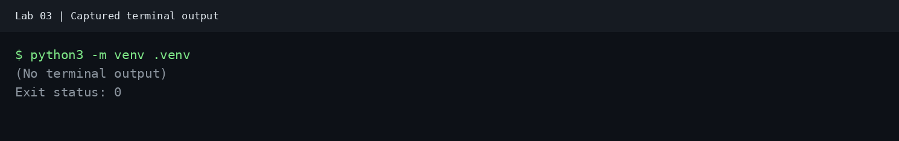
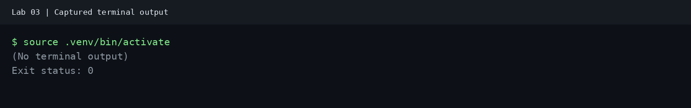
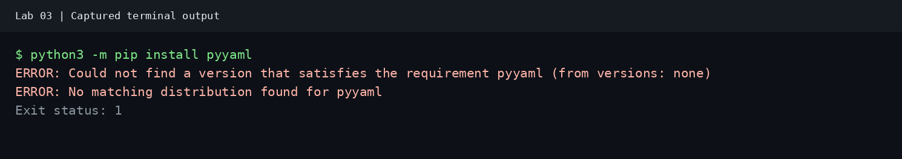
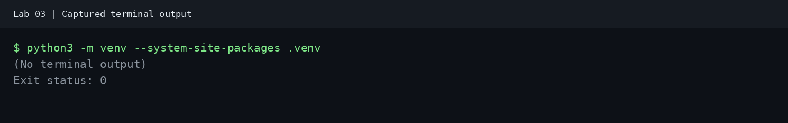
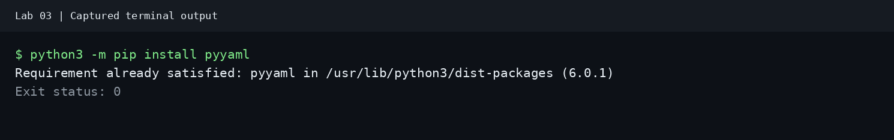
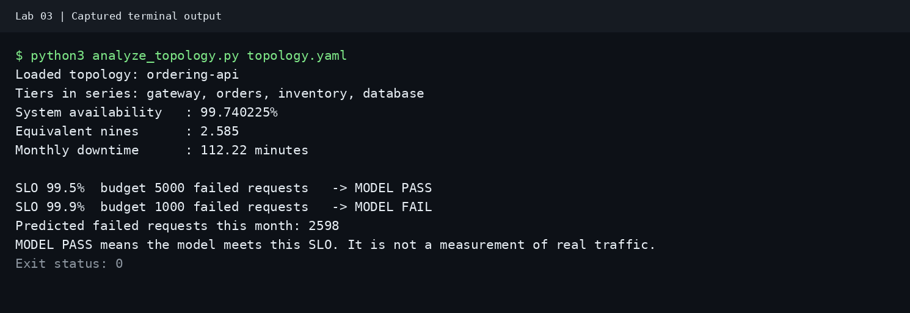
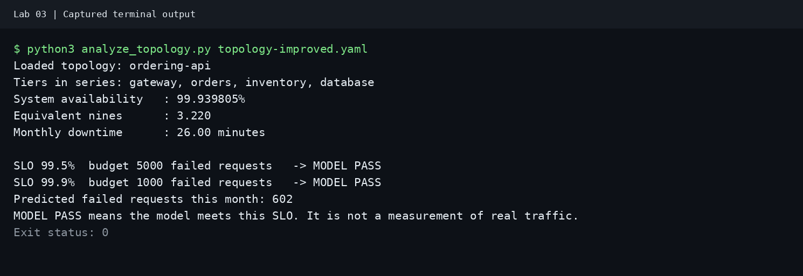
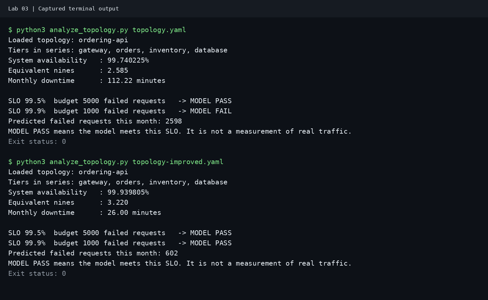

# Topology Driven Reliability Modeling

Build a model of a small service and calculate how often it should be available. Check your answers with Python. Then write a reliability target and a short report explaining your design.

## Objective

By the end of this lab, you can:

- Describe the parts of a service in `topology.yaml`.
- Calculate the availability of the whole service by hand, then check it with Python.
- Choose a reliability target and explain why your design can meet it.

## Deliverable

Create six files: `topology.yaml`, `topology-improved.yaml`, `calculations.md`, `analyze_topology.py`, `slo-document.md`, and `reliability-report.md`. Keep the report to one page. Choose a target for either the starting design, called the baseline, or the improved design.

## How the parts work together


A topology describes how the parts of a system connect. Each stage is called a tier. Availability means the share of time a service can handle requests.

In a serial chain, every tier must work for a request to succeed. Orders and Inventory do different jobs, so the request needs both.

Multiply the availability of the required parts to find the availability of the whole system. This is called composite availability. The whole chain cannot be more available than its least available part.

Will this chain be more or less available than its least available part? Write down your guess and check it in Step 2.

## How extra copies help


Parallel copies do the same job. The diagram shows two database copies as an example. In Step 5, you add copies of Orders and Inventory and keep one database.

An extra copy is called a replica. If either of two copies can handle the request, use this formula:

```text
A_tier = 1 - (1 - A_copy1) x (1 - A_copy2)
```

**Explanation:** The tier fails only when both copies fail.

A tier with one copy has that copy's availability. Step 1 starts with one copy per tier; Step 5 adds more.

## SLO and error budget


The picture makes the error budgets look larger so they are easy to see. Use the numbers for your calculations.

A service level objective (SLO) is a target for how often requests should succeed. A 99.9% SLO allows 0.1% of requests to fail. These allowed failures are the error budget. A higher target allows fewer failures.

## What we assume in this model

A model is a simple version of a real system. Our calculations use these assumptions:

- The client sends requests but is not part of the calculation. We include only Gateway, Orders, Inventory, and Database.
- All four tiers must work for a request to succeed.
- Failures are independent: one part failing does not make another more likely to fail.
- The model leaves out repeated attempts, backup request paths, and the time needed to switch to a working copy.
- If a copy fails, requests reach a working copy. That copy can handle all the traffic alone.
- Copies can fail together if they share a power supply, network, or location. The calculation does not include these shared failures.

The availability values in this lab are practice numbers, not measurements from a real service.

---

## Step 1: Write the topology.yaml file

Create `topology.yaml`. It lists the tiers that a request needs and the copies in each tier. YAML stores data using names, values, and indentation. Use spaces for indentation; each `-` starts a list item.

```text
Client  --->  Gateway  --->  Orders  --->  Inventory  --->  Database
              (99.95%)       (99.9%)       (99.9%)          (99.99%)
```

```yaml
service: ordering-api
window_days: 30
monthly_valid_requests: 1000000
slo_targets_percent: [99.5, 99.9]

# Tiers are required in series. A request must pass through every tier.
# Copies inside a tier are interchangeable parallel replicas.
tiers:
  - name: gateway
    copies:
      - availability_percent: 99.95

  - name: orders
    copies:
      - availability_percent: 99.9

  - name: inventory
    copies:
      - availability_percent: 99.9

  - name: database
    copies:
      - availability_percent: 99.99
```

**What this file does:** It lists every required tier in order, and gives each tier its availability as a percent. Every tier has one copy for now.

For this exercise, assume the Database is a managed multi-AZ service with 99.99% availability. This is a practice assumption, not a provider guarantee. Its internal redundancy is already included in that value, so represent it as one logical copy in the model.

---

## Step 2: Calculate availability by hand

Create `calculations.md` to save your work. Divide each percentage by 100 to get the decimal used in the formulas:

```text
99.95 / 100 = 0.9995
```

Use the formulas below. Here, `A` means availability as a decimal. A 30-day month has 43,200 minutes.

Nines describe how close availability is to 100%: 99% is two nines, and 99.9% is three. A result of 2.585 nines falls between them. Use a calculator with `log10` to find this value.

```text
A_system = A_gateway x A_orders x A_inventory x A_database
nines ≈ -log10(1 - A_system)
downtime_minutes ≈ (1 - A_system) x 43200
```

Try the calculation first, then compare your answer below.

```text
A_system = 0.9995 x 0.999 x 0.999 x 0.9999 ≈ 0.99740225
A_system percent ≈ 99.740225%
nines ≈ 2.585
downtime ≈ 112.22 minutes over 30 days
```

**Explanation:** The whole chain has lower availability than any of its parts, which answers your earlier guess.

---

## Step 3: Compare two SLO targets and their error budgets

Assume 1,000,000 requests count toward the SLO over 30 days. Calculate both budgets, then check the table. The allowed failure fraction is the share of requests that may fail.

```text
allowed_failure_fraction = 1 - (SLO_percent / 100)
allowed_failed_requests = valid_requests x allowed_failure_fraction
```

| SLO target | Allowed failure fraction | Allowed failed requests | Equivalent time allowance | Baseline meets target |
|---|---|---|---|---|
| 99.5% | 0.5% | 5,000 | 216 minutes | Yes |
| 99.9% | 0.1% | 1,000 | 43.2 minutes | No |

The time allowance is the downtime that matches the target over 30 days. To estimate failed requests from downtime, assume requests arrive at the same rate all month and fail while the service is down:

```text
predicted_failed_requests = (downtime_minutes / 43200) x valid_requests
predicted_failed_requests ≈ (112.22 / 43200) x 1,000,000 ≈ 2,598
```

**Explanation:** About 2,598 failures fit within the 99.5% budget but exceed the 99.9% budget.

**Traffic caveat:** The 2,598 estimate assumes a uniform request rate. The same downtime during peak traffic can cause more failures; during quiet periods it can cause fewer. Equivalent downtime alone does not establish a request-based SLO result. Use real request counts to check whether a live service meets its target. If the number of requests changes, calculate the budget again.

---

## Step 4: Write the Python calculator

Create a virtual environment, a separate place for this lab’s Python packages:

```bash
python3 -m venv .venv
```

**Explanation:** Creates a separate place for this lab's Python packages.

<p align="center">
  <a href="images/venv-create-output.png">
    
  </a>
</p>

**What to expect:** This command normally prints nothing on success. The capture records exit status `0`.

```bash
source .venv/bin/activate
```

**Explanation:** Makes this terminal use the lab's Python environment.

<p align="center">
  <a href="images/venv-activate-output.png">
    
  </a>
</p>

**What to expect:** Activation normally prints nothing. Your terminal may add `(.venv)` to its prompt.

```bash
python3 -m pip install pyyaml
```

**Explanation:** Installs the package that reads YAML files.

<p align="center">
  <a href="images/pip-install-output.png">
    
  </a>
</p>

**Captured result:** This environment could not fetch PyYAML. The command returned exit status `1` and `No matching distribution found for pyyaml`. The capture used zero retries and a ten-second timeout to avoid waiting on unavailable package access. On a machine with package access, this command should install PyYAML or report that it is already installed.

### Use the Locally Installed Package

PyYAML was already available in this machine's system Python. The following fallback lets the virtual environment use that local copy; use it only if your system Python already has PyYAML.

```bash
python3 -m venv --system-site-packages .venv
```

**Explanation:** Allows the lab environment to use packages already installed in system Python.

<p align="center">
  <a href="images/venv-fallback-output.png">
    
  </a>
</p>

**What to expect:** The command completes without output. The environment can now see the local PyYAML package.

Run the installation command again in the active environment:

```bash
python3 -m pip install pyyaml
```

**Explanation:** Reports whether the environment can use PyYAML.

<p align="center">
  <a href="images/pip-local-output.png">
    
  </a>
</p>

**Captured result:** `Requirement already satisfied` reports PyYAML **6.0.1** in `/usr/lib/python3/dist-packages`. Both model commands below ran successfully using that copy.

These images render the actual output captured when the commands were run. The added “No terminal output” and exit-status lines describe the capture; they are not text printed by the commands.

Create `analyze_topology.py` with the code below. It calculates each tier first, then the whole system, and checks both targets.

```text
topology.yaml -> load -> parallel availability per tier -> multiply tiers -> nines, downtime, SLO check
```

```python
import sys
import math
import yaml


def required(mapping, key, location):
    if not isinstance(mapping, dict):
        raise ValueError(f"{location} must be a YAML mapping")
    if key not in mapping:
        raise ValueError(f"{location}: missing required key '{key}'")
    return mapping[key]


def number(value, location, upper=None):
    if (isinstance(value, bool) or not isinstance(value, (int, float))
            or not math.isfinite(value) or value <= 0
            or (upper is not None and value > upper)):
        bounds = f"above 0 and at most {upper}" if upper is not None else "above 0"
        raise ValueError(f"{location} must be a finite number {bounds}, got {value!r}")
    return value


def nonempty_list(value, location):
    if not isinstance(value, list) or not value:
        raise ValueError(f"{location} must be a non-empty list")
    return value


def parallel_availability(copies):
    nonempty_list(copies, "copies")
    unavailability = 1.0
    for copy in copies:
        percent = number(required(copy, "availability_percent", "copy"),
                         "availability_percent", upper=100)
        a = percent / 100
        unavailability *= (1 - a)
    return 1 - unavailability


def serial_availability(tier_availabilities):
    total = 1.0
    for a in tier_availabilities:
        total *= a
    return total


def load_topology(path):
    with open(path) as f:
        data = yaml.safe_load(f)
    for key in ("service", "window_days", "monthly_valid_requests",
                "slo_targets_percent", "tiers"):
        required(data, key, "topology")
    if not isinstance(data["service"], str) or not data["service"].strip():
        raise ValueError("service must be a non-empty string")
    number(data["window_days"], "window_days")
    requests = number(data["monthly_valid_requests"], "monthly_valid_requests")
    if not isinstance(requests, int):
        raise ValueError("monthly_valid_requests must be a positive integer")
    for slo in nonempty_list(data["slo_targets_percent"], "slo_targets_percent"):
        number(slo, "slo_targets_percent entry", upper=100)
    for index, tier in enumerate(nonempty_list(data["tiers"], "tiers")):
        location = f"tiers[{index}]"
        name = required(tier, "name", location)
        if not isinstance(name, str) or not name.strip():
            raise ValueError(f"{location}.name must be a non-empty string")
        copies = nonempty_list(required(tier, "copies", location), f"{location}.copies")
        for copy_index, copy in enumerate(copies):
            copy_location = f"{location}.copies[{copy_index}]"
            number(required(copy, "availability_percent", copy_location),
                   f"{copy_location}.availability_percent", upper=100)
    return data


def main():
    path = sys.argv[1] if len(sys.argv) > 1 else "topology.yaml"
    data = load_topology(path)

    tier_availabilities = [parallel_availability(t["copies"]) for t in data["tiers"]]
    a_system = serial_availability(tier_availabilities)

    minutes_in_window = data["window_days"] * 24 * 60

    print(f"Loaded topology: {data['service']}")
    print(f"Tiers in series: {', '.join(t['name'] for t in data['tiers'])}")
    print(f"System availability   : {a_system * 100:.6f}%")

    if a_system >= 1.0:
        # log10(0) is undefined, so 100% modeled availability is a special case
        print("Equivalent nines      : infinite (100% modeled availability)")
        downtime = 0.0
    else:
        nines = -math.log10(1 - a_system)
        downtime = (1 - a_system) * minutes_in_window
        print(f"Equivalent nines      : {nines:.3f}")

    print(f"Monthly downtime      : {downtime:.2f} minutes")
    print()

    valid_requests = data["monthly_valid_requests"]
    predicted_failed = (downtime / minutes_in_window) * valid_requests

    for slo in data["slo_targets_percent"]:
        budget = valid_requests * (100 - slo) / 100
        verdict = "MODEL PASS" if predicted_failed <= budget else "MODEL FAIL"
        print(f"SLO {slo}%  budget {budget:.0f} failed requests   -> {verdict}")

    print(f"Predicted failed requests this month: {predicted_failed:.0f}")
    print("MODEL PASS means the model meets this SLO. It is not a measurement of real traffic.")


if __name__ == "__main__":
    try:
        main()
    except (OSError, yaml.YAMLError, ValueError) as exc:
        print(f"Error: {exc}", file=sys.stderr)
        sys.exit(1)
```

**What this file does:** It checks your calculations and prints MODEL PASS or MODEL FAIL for each target.

The script checks required keys, list structure, and numeric ranges before calculating. Missing files, invalid YAML, and invalid values produce an `Error:` message and a nonzero exit status. For example, a typo in `monthly_valid_requests` produces `Error: topology: missing required key 'monthly_valid_requests'`. Fix the named field and run again.

The script accepts availability and SLO targets above 0% and up to 100%, a positive window length, and a positive integer request count. MODEL PASS means the calculation meets the target; you still need measurements from a live service.

---

## Step 5: Add extra service copies

Create `topology-improved.yaml`. Add a second copy of Orders and Inventory so either copy can do the same job. Keep one Gateway and one Database.


```yaml
service: ordering-api
window_days: 30
monthly_valid_requests: 1000000
slo_targets_percent: [99.5, 99.9]

tiers:
  - name: gateway
    copies:
      - availability_percent: 99.95

  - name: orders
    copies:
      - availability_percent: 99.9
      - availability_percent: 99.9

  - name: inventory
    copies:
      - availability_percent: 99.9
      - availability_percent: 99.9

  - name: database
    copies:
      - availability_percent: 99.99
```

**What this file does:** It adds a second copy of Orders and Inventory so each tier can keep working if one copy fails.

Before running Python, calculate by hand.

```text
A_orders ≈ 1 - (1 - 0.999)^2 ≈ 0.999999
A_inventory ≈ 1 - (1 - 0.999)^2 ≈ 0.999999
A_system ≈ 0.9995 x 0.999999 x 0.999999 x 0.9999 ≈ 0.99939805
```

**Explanation:** Calculate each pair of copies first, then multiply the four tier values.

Gateway and Database are still single points of failure: if either fails, the whole service stops working. A shared power or network problem can also stop both copies of a tier.

---

## Step 6: Write the SLO document

Write `slo-document.md` to record your target and how you will measure it. Include:

- Which parts are included and which requests count as good or bad, using Lab 02’s rules.
- The time period: the most recent 30 days.
- Both targets and their budgets from Step 3.
- Your chosen target and why you chose it.
- How you will count good and bad requests in the live service.

Write your own version first, then compare it with this example.

```markdown
# SLO Document, ordering-api

## Service boundary
The calculation includes Gateway, Orders, Inventory, and Database. It does not include the client.
Following Lab 02, skip cancelled requests (499) and health checks (`/healthz`).
Of the remaining requests, count 2xx, 3xx, and 4xx responses as good and 5xx responses as bad.
The service level indicator (SLI) is good requests divided by all counted requests.

## Measurement window
Use the most recent 30 days, matching `window_days` in `topology.yaml`.
This is a rolling window: it moves forward each day.

## Targets to compare

These example budgets use 1,000,000 counted requests in 30 days.
For real traffic, multiply the counted requests by the allowed failure fraction.

| Target | Allowed failure fraction | Allowed failed requests per month | Equivalent time allowance |
|---|---|---|---|
| 99.5% | 0.5% | 5,000 | 216 minutes |
| 99.9% | 0.1% | 1,000 | 43.2 minutes |

The baseline topology, at 99.740225% modeled availability, meets the 99.5% target but not the 99.9% target.

## Selected target
Choose 99.9% for the improved design in `topology-improved.yaml`, after adding the extra copies.
Its calculated availability is 99.939805%, which meets this target in the model.

## How this will be measured in production
Count good and bad responses at the gateway. Use these counts to check the target.
Use separate checks from outside the system to find failures that never reach the gateway.
The model helps with planning; live traffic may give different results.
```

**What this file does:** It records your target, the design it applies to, and how to check real results.

---

## Step 7: Write the reliability report

Write a one-page `reliability-report.md` to explain your results and suggested change. Include:

- The service diagram and the assumptions used in the calculations.
- Results for the starting design: availability, nines, downtime, and estimated failed requests.
- The extra copies you plan to add.
- A table comparing results before and after the change.
- The design and target you recommend, with a reason.
- What the model leaves out.

Write your own version first, then compare it with this example.

```markdown
# Reliability Report, ordering-api

## Service and assumptions
Client -> [Gateway -> Orders -> Inventory -> Database]

Only the parts inside brackets are included in the calculation. We assume failures are independent
and working copies can handle all requests. We leave out repeated attempts and switching delays.

## Baseline result
| Metric | Value |
|---|---|
| Composite availability | 99.740225% |
| Equivalent nines | 2.585 |
| Monthly downtime | 112.22 minutes |
| Predicted failed requests, 1,000,000 valid requests | 2,598 |

The model meets the 99.5% target but misses the 99.9% target.

## Proposed change
Add one extra copy each to Orders and Inventory. Keep one Gateway and one Database.

## Before and after
| Metric | Baseline | Improved |
|---|---|---|
| Availability | 99.740225% | 99.939805% |
| Nines | 2.585 | 3.220 |
| Monthly downtime | 112.22 min | 26.00 min |
| Model meets 99.5% SLO | Yes | Yes |
| Model meets 99.9% SLO | No | Yes |

## Recommendation
Use the improved design with two copies each of Orders and Inventory. Choose a 99.9% target
for that design. Improve Gateway and Database next: failure of either can still stop the service.

## Model limitations
A shared power or network problem can stop both copies at once. Repeated requests and backup
paths also change the results. Busy periods have more requests, so one minute of downtime
does not always cause the same number of failures.
```

**What this file does:** It compares both designs and explains your choice and what could go wrong.

---

## Step 8: Run the following commands in the terminal

Your virtual environment from Step 4 should already be active.

Run the starting design first:

```bash
python3 analyze_topology.py topology.yaml
```

**Explanation:** Calculates availability and compares the starting design with both targets.

<p align="center">
  <a href="images/baseline-output.png">
    
  </a>
</p>

**What to expect:** The baseline has **99.740225%** availability, **2.585** nines, and **112.22 minutes** of downtime over 30 days. Its **2,598** predicted failures fit within the 99.5% target's 5,000-failure budget, but exceed the 99.9% target's 1,000-failure budget.

Run the design with extra Orders and Inventory copies:

```bash
python3 analyze_topology.py topology-improved.yaml
```

**Explanation:** Calculates the improved design with two copies of each app tier.

<p align="center">
  <a href="images/improved-output.png">
    
  </a>
</p>

**What to expect:** The improved design has **99.939805%** availability, **3.220** nines, and **26.00 minutes** of downtime. Its **602** predicted failures fit within both budgets, so both targets show `MODEL PASS`.

<p align="center">
  <a href="images/run-output.png">
    
  </a>
</p>

| Result over 30 days | Baseline | Improved |
| --- | --- | --- |
| Availability | 99.740225% | 99.939805% |
| Expected downtime | 112.22 minutes | 26.00 minutes |
| Predicted failed requests | 2,598 | 602 |
| 99.5% target | MODEL PASS | MODEL PASS |
| 99.9% target | MODEL FAIL | MODEL PASS |

`MODEL PASS` describes the calculation, not measured live traffic. Both commands completed with exit status `0`; `MODEL FAIL` for a target does not mean the Python command failed.

---

## Understanding checks

1. Why does a request need both Orders and Inventory?
2. Why can the system fall under 99.9% even though every component is at least 99.9% available on its own?
3. Does choosing a higher target make the service more reliable by itself? Why?
4. Give one real reason the actual availability could be lower than this model predicts.
5. What would you measure in the live service to check the 99.9% target?

## Conclusion

You described a service, calculated its availability, and checked your answers with Python. You also chose a target and explained how extra copies help meet it. Use this model to study more complex request paths in later labs.
