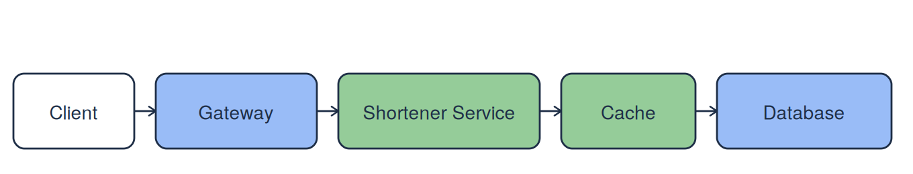
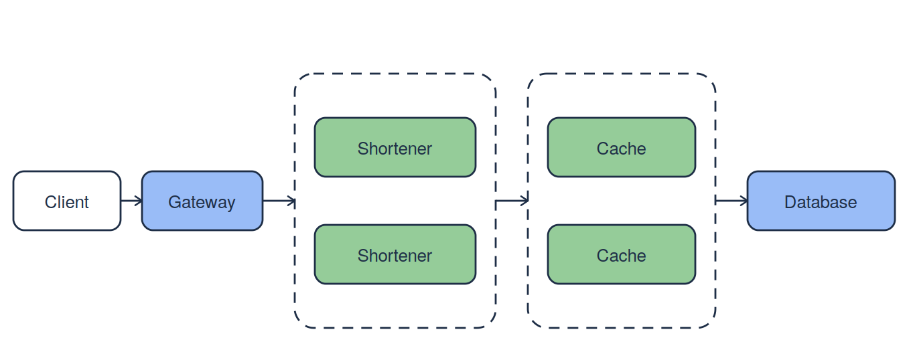

# Reliability Baseline for a URL Shortener


Combine Labs 01, 02, and 03 into a reliability reference for later milestones.

## Objective

```text
Model -> Calculate -> Set targets
```

**Explanation:** Connect the model to a measurable reliability target.

By the end, you can:

- Calculate availability and equivalent nines.
- Choose a service level objective (SLO), a target for successful requests.
- Record error budgets and alert thresholds.

## Deliverable

```text
L1 calculator + L2 SLO + L3 topology -> reliability-baseline.md
```

**Explanation:** Combine the earlier results into one reference document.

Create two files: `reliability-baseline.md` for your reliability decisions and `reliability_baseline_calc.js` for the Node.js calculator. Keep both in the same folder. AI tools may help; verify their output.

## Required dependencies



Every modeled request needs Gateway, Shortener Service, Cache, and Database. The client is excluded. Real cache hits may skip Database; this simplified chain is not a worst-case guarantee.

## Parallel copies



Replicas are interchangeable copies, not shards holding different data. Either Cache copy must hold the required data. Either copy of each replicated tier must handle the full load alone, and traffic must reach a working copy. Assume independent failures, no retries, no switching delay, and no shared failures. Database is one logical managed multi-AZ service; its assumed 99.99% already includes internal redundancy.

## Step 1: Set up Node.js and the project

Use an Ubuntu/Debian terminal and a text editor, as in Labs 1–3. Node.js runs JavaScript outside the browser. If you already installed it for the earlier labs, check its version first:

```bash
node --version
```

**Explanation:** Prints the installed Node.js version. A result such as `v22.23.1` means the runtime is available; your version may differ. If the command succeeds, skip installation below.

### Install Node.js if needed

If the terminal reports `node: command not found`, run:

```bash
sudo apt update
sudo apt install -y nodejs
```

**Explanation:** Refreshes the Ubuntu/Debian package list and installs Node.js. Enter your system password if prompted and wait for installation to finish.

Check again:

```bash
node --version
node -e "console.log('Node.js is ready')"
```

**What to expect:** A version beginning with `v`, followed by `Node.js is ready`. This calculator uses built-in JavaScript features only. No npm packages, YAML library, or `npm init` step is needed.

See the [Node.js command-line documentation](https://nodejs.org/api/cli.html) for version checks and script execution.

### Create the lab folder and files

From your course working directory, run:

```bash
mkdir -p m3-l4
cd m3-l4
touch reliability-baseline.md reliability_baseline_calc.js
pwd
ls
```

**Explanation:** Creates the lab folder and two empty files. `pwd` shows your current directory; `ls` lists its contents.

**What to expect:** Your directory ends in `m3-l4`, and both filenames appear. Open this folder in your editor and keep your terminal here for the remaining commands.

```text
m3-l4/
  reliability-baseline.md
  reliability_baseline_calc.js
```

---

## Step 2: Write the assumptions

```text
Components + request rules + traffic -> model inputs
```

**Explanation:** Define the inputs before calculating availability.

Open `reliability-baseline.md` and record these planning inputs. Values are practice assumptions, not measurements or provider guarantees.

| Tier | Availability | Baseline copies | Improved copies |
| :--- | ---: | ---: | ---: |
| Gateway | 99.95% | 1 | 1 |
| Shortener Service | 99.90% | 1 | 2 |
| Cache | 99.95% | 1 | 2 |
| Database | 99.99% | 1 logical | 1 logical |

Use a rolling 30-day window: 43,200 minutes and 5,000,000 assumed valid requests.

Carry forward Lab 02: exclude 499 responses and `/healthz`. Count remaining completed 2xx/3xx/4xx as good and 5xx as bad. Count retries separately. The service level indicator (SLI) is `good / valid`; use external checks for failures that never reach the gateway.

---

## Step 3: Write the calculator

```text
Copies -> tier availability -> composite availability
```

**Explanation:** Calculate each tier first, then multiply the required tiers.

Open `reliability_baseline_calc.js` in your editor and paste the complete code below. Save the file before running it. Multiply required tiers; parallel copies fail only when both fail.

Equivalent nines express closeness to 100%: 99% is two nines; 99.9% is three. Use `-log10(1 - availability)`, using decimal availability.

```javascript
const WINDOW_DAYS = 30;
const VALID_REQUESTS = 5_000_000;
const SLO_TARGETS = [99.9, 99.95];
const BASELINE = {
  Gateway: 0.9995,
  "Shortener Service": 0.999,
  Cache: 0.9995,
  Database: 0.9999,
};

// Every required tier must work, so multiply its availability.
function serial(values) {
  return values.reduce((total, availability) => total * availability, 1);
}

// A parallel tier fails only when all interchangeable copies fail.
function parallel(...copies) {
  const allFail = copies.reduce((total, availability) =>
    total * (1 - availability), 1);
  return 1 - allFail;
}

function summarize(tiers) {
  const availability = serial(Object.values(tiers));
  const failedFraction = 1 - availability;
  const nines = failedFraction === 0 ? Infinity : -Math.log10(failedFraction);
  const downtime = failedFraction * WINDOW_DAYS * 24 * 60;
  const failures = failedFraction * VALID_REQUESTS;
  return { availability, nines, downtime, failures };
}

function main() {
  // Copy the baseline so its original inputs stay available for comparison.
  const improved = { ...BASELINE };
  for (const tier of ["Shortener Service", "Cache"]) {
    improved[tier] = parallel(BASELINE[tier], BASELINE[tier]);
  }

  for (const [name, tiers] of [["Baseline", BASELINE], ["Improved", improved]]) {
    const { availability, nines, downtime, failures } = summarize(tiers);
    console.log(
      `${name}: ${(availability * 100).toFixed(4)}%, ` +
      `${nines.toFixed(3)} nines, ${downtime.toFixed(2)} min, ` +
      `${failures.toFixed(0)} predicted failed requests`
    );
    for (const target of SLO_TARGETS) {
      const verdict = availability >= target / 100 ? "MODEL PASS" : "MODEL FAIL";
      console.log(`  SLO ${target}%: ${verdict}`);
    }
  }

  console.log("\nPlanning budgets:");
  for (const target of SLO_TARGETS) {
    const allowedFraction = (100 - target) / 100;
    const budget = VALID_REQUESTS * allowedFraction;
    const minutes = WINDOW_DAYS * 24 * 60 * allowedFraction;
    console.log(
      `  ${target}%: ${budget.toFixed(0)} failed requests, ` +
      `${minutes.toFixed(2)} equivalent min`
    );
  }

  console.log("\nBaseline improvement if one tier becomes perfect:");
  const original = serial(Object.values(BASELINE));
  for (const tier of Object.keys(BASELINE)) {
    const changed = { ...BASELINE, [tier]: 1 };
    const gain = (serial(Object.values(changed)) - original) * 100;
    console.log(`  ${tier}: +${gain.toFixed(6)} percentage points`);
  }
}

main();
```

**What this file does:** Calculates both designs, budgets, and the gain from making each baseline tier perfect.

---

## Step 4: Write the SLO decision

```text
Composite availability -> compare target -> record decision
```

**Explanation:** Check whether the design supports the chosen target.

Keep Lab 02's 99.9% target conditional on deploying both replicated tiers. Add 99.95% as a new stretch target.

| Target | Allowed failures at 5 million requests | Equivalent minutes | Baseline | Improved |
| :--- | ---: | ---: | :--- | :--- |
| 99.9% | 5,000 | 43.20 | Fail | Pass |
| 99.95% | 2,500 | 21.60 | Fail | Fail |

The request budget is `valid requests × (1 - target / 100)`. Equivalent downtime assumes uniform traffic; busy-period outages can cause more failures. Recalculate budgets from actual traffic.

Gateway's 99.95% caps the chain. Reaching 99.95% requires improving or bypassing that dependency, then checking the whole model. Improving Database alone is insufficient.

---

## Step 5: Write the alert policy

```text
Bad / valid requests -> burn rate -> paired windows -> alert
```

**Explanation:** Check both alert windows before triggering the action.

Burn rate means `observed bad fraction / allowed bad fraction`. Keep Lab 02's paired windows: both must exceed the threshold.

| Alert | Long + short window | Burn rate | Bad requests | Action |
| :--- | :--- | ---: | ---: | :--- |
| Fast | 1h + 5m | >14.4x | >1.44% | Page |
| Medium | 6h + 30m | >6x | >0.60% | Page |
| Slow | 3d + 6h | >1x | >0.10% | Ticket |

These are lookback windows, not waiting periods. With steady traffic, 14.4x for one hour spends 2% of the monthly budget. If the SLO changes, recalculate request budgets and error-percentage thresholds. Review tickets the next business day; prioritize reliability fixes when the budget runs out.

---

## Step 6: Run and verify the calculator

```text
Calculator -> terminal results -> baseline document
```

**Explanation:** Use the output to verify your documented results.

From `m3-l4`, confirm that the saved calculator is present and check its JavaScript syntax:

```bash
ls
node --check reliability_baseline_calc.js
```

**Explanation:** `ls` should show both lab files. `node --check` checks syntax without executing the calculator. It prints nothing when the syntax is valid. If it reports an error, correct the indicated line and save again.

Run the calculator:

```bash
node reliability_baseline_calc.js
```

**Explanation:** Prints modeled results and compares them with both targets.

Expected terminal output:

```text
Baseline: 99.7901%, 2.678 nines, 90.66 min, 10493 predicted failed requests
  SLO 99.9%: MODEL FAIL
  SLO 99.95%: MODEL FAIL
Improved: 99.9399%, 3.221 nines, 25.97 min, 3006 predicted failed requests
  SLO 99.9%: MODEL PASS
  SLO 99.95%: MODEL FAIL

Planning budgets:
  99.9%: 5000 failed requests, 43.20 equivalent min
  99.95%: 2500 failed requests, 21.60 equivalent min

Baseline improvement if one tier becomes perfect:
  Gateway: +0.049920 percentage points
  Shortener Service: +0.099890 percentage points
  Cache: +0.049920 percentage points
  Database: +0.009980 percentage points
```

**What to expect:** Baseline: 99.7901%, 2.678 nines, 90.66 minutes. Improved: 99.9399%, 3.221 nines, 25.97 minutes. Only the improved design passes 99.9%. Predicted failures are 10,493 and 3,006 under uniform traffic. These estimates are not measured SLO results.

`MODEL FAIL` means the design falls below the target; it does not mean Node.js failed. The final section changes one baseline tier at a time to 100% availability. The largest gain belongs to Shortener Service; use this evidence in your reflection.

If `node` is not found, complete Step 1. If Node.js reports `Cannot find module`, use `pwd` and `ls` to check that you are in `m3-l4` and that the filename is exactly `reliability_baseline_calc.js`. If nothing prints, check that the file contains the full code, including `main();`, and save it. After changing inputs, save the file and rerun the same command.

---

## Step 7: Complete the baseline

```text
Inputs + results + policy + reflection -> reliability baseline
```

**Explanation:** Record the evidence behind your reliability decision.

Organize `reliability-baseline.md` into scope, assumptions, topology results, SLO decision, budgets, alerts, future requirements, and reflection. Include the calculator command, `node reliability_baseline_calc.js`, and the verified output. Save the completed document and submit it together with `reliability_baseline_calc.js`.

Require later milestones to preserve the replica assumptions and recalculate after dependency changes. Track Gateway and Database as required dependencies. Record the date and reason for revisions. Compare production SLIs with this model.

Write a 3-5-line reflection: Which component assumption most affected availability? Did Lab 02's target survive, or did the architecture need revision? Use the calculator's sensitivity results as evidence.

---

## Conclusion

```text
Reliability baseline -> later milestone reviews
```

**Explanation:** Recheck the baseline when later milestones change the service.

Review later architecture changes against this baseline. Compare predictions with measured request reliability.
